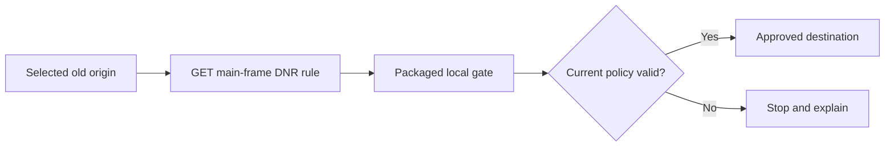
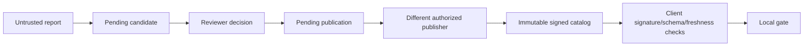

# Web Switcher architecture

Web Switcher follows an explicitly selected local mapping or a signed, reviewed migration record. It abstains when it lacks a current supported decision. Reachability, site identity, and deep-page compatibility are separate questions.

## Components

| Path | Responsibility | Trust boundary |
| --- | --- | --- |
| `extension/` | MV3 background, selected-origin DNR rules, local route gate, settings and popup | Runs packaged code; no remote scripts or automatic per-navigation lookup |
| `packages/security/` | Closed signed-record validation, browser Web Crypto ES256 verification, sequence/digest memory, experimental owner CLI | Signature authenticity does not establish website identity |
| `apps/web/` | React public lookup/report interface and review/publish console | Same-origin session authentication; untrusted evidence is rendered as text |
| `backend/` | Java 21/Spring API, JDBC/Flyway persistence, review records, durable budgets, signed catalog publication and audit | Public submissions never directly become active routes |
| `fetcher/` | Separately authenticated, bounded HTTPS probe process | No DB or registry signing credentials; deployment must also constrain egress |
| `research/` | Preserved feasibility experiments and historical results | Synthetic demonstrations are not real-world effectiveness results |
| `infra/` | Local demo containers and backup/release support | A configuration file is not evidence of deployed isolation |

The extension remains packaged plain JavaScript so the recovered gate can be exercised directly. React/TypeScript is used for the web application; the proposed WXT extension migration is not represented as complete.

## Navigation

The gate resolves the destination from current local state. It never trusts a `target=` parameter. It checks mapping/catalog generation, source identity, expiry, pause and permissions again at use time. Query strings and fragments are dropped. Sensitive or ambiguous paths require a separate user decision. Session loop guards prevent repeated switching in one tab; stored receipts contain origin pairs and timestamps rather than original paths.

DNR only intercepts top-level GET navigation for selected granted source origins. POSTs, iframes, subresources, unlisted subdomains and lookalike hostname suffixes are outside that rule. Browsers may discard source fragments before request matching, so fragment preservation is unsupported.

## Review and publication

Pending reviewer decisions and activated catalog data stay separate. Catalog publication uses a monotonically increasing sequence and immutable signed bytes. A client remembers sequence plus digest and rejects rollback or same-sequence conflicts. A lower environment or staging key must never become a production trust anchor merely because the same API serves it.

The local demo creates its own persistent signing key and synthetic `.test` family. That key is not a production root. Outside demo, `APP_ROLE=api` refuses a private publishing key and `APP_ROLE=publisher` requires one. An API process without a key cannot publish. Startup and endpoint role checks exist, but OS identity, distinct DB privileges, immutable database grants and a key-isolated publisher deployment remain production gates.

## Data and network policy

An explicit public lookup sends a hostname only; it still discloses the requester's IP to the service. Reports contain two hostnames and a free-text reason, so users must omit private data. There is no universal discovery service, automated trust promotion, or client browsing-history upload.

The fetcher validates every DNS answer, pins allowed addresses through its transport, preserves TLS hostname verification and bounds redirects, bytes and time. A deployed firewall/proxy must independently block private, metadata and application networks. Its supported direct-connect model cannot prove the upstream peer IP through an arbitrary HTTP CONNECT proxy. Public crawling is not enabled merely by building its JAR.
