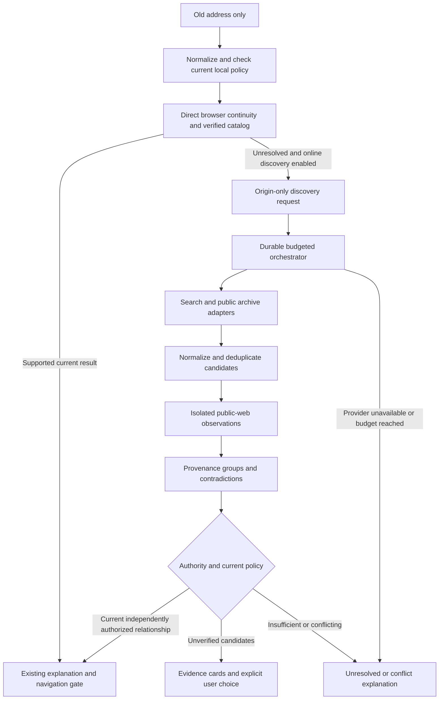

# Autonomous Internet discovery: implementation plan

**Implementation update, 29 October 2026:** A bounded archive-first extension and optional authenticated Node/SQLite search service are now implemented. Read [delivered scope](INTERNET_DISCOVERY_STATUS.md) and [operation/deployment](INTERNET_DISCOVERY_OPERATION.md) for current behavior. The design below remains the original broader proposal; its planned Java/V2 storage approach was simplified to a separate SQLite service, and its research/provider/owner features are not all delivered.

Status: **proposed; no online-search implementation is delivered by this document**. Updated 28 October 2026 (Asia/Kolkata). This plan extends the [implemented browser continuity engine](AUTOMATIC_CONTINUITY.md) and the original [research plan, section 9](WEB_SWITCHER_PLAN.md#9-discovery-and-verification). It does not rewrite historical validation or authorize an unverified search result as a signed route.

## 1. Product outcome

A person enters an old public website address and chooses **Find current address**. They do not need to know a replacement, supply a history file, enter a brand name, create a mapping or have used the extension before. If direct signals cannot establish a successor, an explicitly enabled online-discovery service investigates public Internet evidence on their behalf. It returns a reachable, supported successor when authority permits, clearly labelled suggestions when identity remains uncertain, or an honest unresolved result.

History can be gathered from public archives, public announcements, indexed links, previously reviewed records and optional consented observations. Local history is useful but is not an input requirement. The service cannot recover information that has left no observable trace, and cannot prove the identity of two unrelated domains from their names alone.

### User journeys and acceptance examples

| Situation | Required outcome |
| --- | --- |
| First installation; A is dead; an independent public archive and established operator channel identify B | Discover and check B without a user-provided B or local A→B history. Explain the dated supporting sources and authority classification. |
| A is dead; search returns B and a clone C | Retrieve candidates, compare evidence and present uncertainty. Do not select the highest search result as an automatic route. |
| A→B was never observed locally; public evidence links A→B→C | Build a provenance-labelled inferred candidate chain, check C now, and distinguish historical observations from current authority. |
| A is live and announces B | Preserve today's inexpensive direct browser flow; online search is unnecessary unless a conflict needs investigation. |
| A belongs to withdrawn signed registry history | Preserve the existing signed barrier at every reached origin. Online discovery cannot clear it or fall back to weaker navigation authority. |
| An operator has a previously trusted migration key and signs a fresh move to B | After the owner lifecycle is actually implemented, validate the prior pin, signature, sequence, expiry, scope, revocation and live availability before automatic eligibility. A key discovered on B is not a prior pin. |
| Candidates are reachable only from the server's region | Report the vantage and time. Check the chosen target from the user's browser before claiming that user can reach it. |
| A is unindexed, no archive exists and no independent source connects it to B | Report unresolved. Do not request that the user invent a destination or silently guess one. Optional manual input remains available. |

The supplied `vegamovies.rs` / `new1.vegamovies.lease` pair is an unverified example of the desired interaction, not a production seed, ownership claim, mandatory provider result or gold-labelled benchmark case. Any live study must establish its own dated ground truth and permitted retrieval scope.

## 2. What exists and what must be built

| Capability | Current state | Planned change |
| --- | --- | --- |
| Old-address-only browser input | Implemented | Keep it as the only required input. |
| HTTP/Refresh/inert metadata traversal | Implemented | Remains the first, cheap path. |
| Seven-day origin-only graph and dead-known-hop recovery | Implemented | Keep existing expiry/conflict rules; attach new evidence only through an explicit ingestion policy. |
| Signed catalog verification, rollback memory and alias reservations | Implemented | Remain authoritative constraints for online results too. |
| Restricted durable worker and internal safe fetcher | Implemented for bounded observation | Reuse process/isolation patterns, not an assumption that existing queue lifetimes or contracts already support web search. |
| Internet search, archive retrieval and cross-source candidate fusion | Not implemented | Add versioned provider adapters and a dedicated discovery orchestrator. |
| Public candidate-result API and candidate-selection UI | Not implemented | Add a new contract; keep current `/v1/lookups` semantics unchanged. |
| Owner bootstrap/enrollment/key recovery | Offline tools only | Separate later delivery; never infer that this lifecycle exists from a signing CLI. |
| Real-world precision/coverage/cost measurements | Not established | Build and evaluate a dated dataset before promoting automatic behavior. |

The [idea register](INTERNET_DISCOVERY_IDEAS.md) records alternatives and rejected approaches. The [implementation backlog](INTERNET_DISCOVERY_BACKLOG.md) turns the selected design into dependent tasks. The [evaluation and threat plan](INTERNET_DISCOVERY_EVALUATION.md) defines evidence needed for release. All are planning documents.

## 3. Recommended design

Use a **hybrid**: keep browser-local explicit continuity independent of a backend; add an opt-in server service for wider Internet investigation. Use one supported official search API and one archive/index metadata adapter for the first live slice, behind interchangeable interfaces. Provider selection requires checking current availability, terms, response limits, geography and cost before implementation. This planning turn does not verify current commercial products, endpoints or prices.

The browser does not crawl search-result pages, embed a shared provider secret, inspect the person's unrelated browsing history or run downloaded JavaScript. The server does bounded work on one explicitly selected hostname. An unavailable online service leaves local discovery and existing signed/manual routing operational.



### Execution alternatives

| Design | Benefit | Cost or constraint | Decision |
| --- | --- | --- | --- |
| Browser-only public search | No central service | Search UI changes, origin permissions, user IP/query disclosure, API keys and extension-store behavior are difficult to manage; public HTML search scraping is brittle | Keep direct browsing local; do not choose HTML search scraping as the production discovery foundation. |
| Server-only resolver | Central quota/caching, public-source adapters and independent fetch isolation | Hosting, provider credentials, operating cost and hostname disclosure to service | Useful optional online service; must not become a dependency of current local functionality. |
| Hybrid local plus server | Fast existing behavior and wider first-use discovery | Two availability vantages and explicit client/server evidence boundaries | Recommended. |
| Entirely offline catalog | Predictable and inexpensive client | A maintained catalog cannot discover an unlisted family on demand | Retain as a strong known-record source, not the complete solution. |
| Distributed observation network | May learn moves before hosts disappear | Sybil resistance, consent, peer authenticity and retention complexity | Later experiment; no silent collection of users' navigation history. |

## 4. Discovery pipeline

### 4.1 Normalize one selected source

Accept a complete public HTTPS address or hostname in the existing UI. Locally strip path, query and fragment before requesting online work; reject credentialed input outright. Reject unsupported schemes, credentialed inputs, private/reserved literal targets, control characters and custom ports according to the implemented origin policy. Display normalized IDN/ASCII forms and confusable warnings. Resolve registrable-domain grouping using a versioned public-suffix dataset; shared suffixes are not identity evidence.

The external job contract accepts a normalized **hostname**, not an arbitrary fetch URL or a user-provided list of internal service endpoints. Subdomains can themselves reveal sensitive context; origin-only is data minimization, not anonymity. The disclosure explains exactly which hostname will leave the browser.

### 4.2 Reuse current policy before spending

Check manual overrides, current signed records, remembered evidence and withdrawal/reservation barriers. A signed record must be valid now; cached expiry or revocation never creates permission for weaker routing. Existing conflicts stay conflicts. Job caches are keyed by source plus policy/provider version and expiry; a cached candidate cannot retain obsolete navigation eligibility.

Use direct browser observations when available. Do not resend a user's full local history to improve a server search. If public historical context is needed, the server obtains it from configured public sources.

### 4.3 Generate queries without requiring brand input

Start with exact old-hostname queries. Candidate templates include a quoted old hostname, that hostname plus a migration term, and an optional public brand/project term extracted from an admissible historical page. Query templates are data produced by packaged rules, not remote instructions. Do not include private page paths, account/session values, a stable user identifier or hidden browser history.

Maintain a small multilingual migration-term vocabulary; select language from admissible public evidence or an explicitly chosen UI language. A hostname-derived brand is a hypothesis. A generic word such as `news` must not broaden a query into unrestricted crawling. A model may suggest bounded query variants in a later experiment; its answer is never a discovered fact or destination authority.

### 4.4 Obtain bounded candidate leads

The initial adapters return structured leads from an official search API and a public archive/index source. Prefer index metadata before downloading old page bodies. Public links, canonical/sitemap records, established repository/project metadata and dated announcements can generate candidates. DNS/RDAP/CT/common infrastructure can support investigation but cannot establish a successor relationship.

Strip tracking queries/fragments and normalize candidate origins before any candidate fetch. Reject private/credentialed/unsupported targets. Retain only safe evidence locators permitted by source terms. An archived redirect is a historical observation, not proof that the target is reachable today. Replayed archive pages are inert text; never execute their scripts or load their subresources.

Archive lookup may follow multiple dated public aliases when A is already gone. Every extra lookup consumes a job budget and retains its original provenance and date. Loops, source gaps and domain re-registration must remain visible; path compression cannot create a missing edge.

### 4.5 Deduplicate and preserve provenance

Normalize and cap origins before probing. Group duplicate URLs, syndicated stories, search snippets quoting the same announcement and archive replays of that announcement into upstream provenance groups. Ten copies of one operator claim count as one claim. Multiple search engines indexing one page do not supply independent identity evidence.

Record whether a channel's historical relationship to the old site was established before the disputed migration. A new candidate's own footer linking to its own social account is circular support. Independently hosted is not automatically independently controlled.

### 4.6 Observe candidates through the isolated fetcher

Use constrained HTTPS GET observations, certificate validation, all-address public-DNS checks, actual connected-address pinning, robots handling, redirect checks and hard resource bounds. Validate every hop. Do not fetch a public result URL through an internal search credential channel. The fetcher has no database, provider API key, administrator cookie, cloud identity or publishing key.

Observe a homepage first. Up to three selected public sample paths may be inspected only if they come from admissible public evidence and fit the global budget. No account/login/payment/download/session traversal. A successful response is availability evidence at a particular time and vantage; parked domains, unrelated content, login/challenge responses and uniform error pages are separately classified.

The existing `/resolve` endpoint has its own bounds; it is not a new global-budget/cancellation protocol. Before reuse, reserve worst-case child requests including robots and redirects, or extend its private contract to consume a fenced remaining-job budget. An HTTP cancellation does not prove the remote worker stopped or that a paid call was not charged.

### 4.7 Build features, contradictions and temporal relationships

Supporting features may include public text fingerprints, stable document identifiers, project/repository identifiers, distinctive public contact references, legal/project metadata, dated inbound-link changes and explicit migration statements. Content/DOM/logo similarity is ranking evidence: a clone can copy it perfectly and a legitimate redesign can change it completely.

Keep contradictions first-class: unrelated ownership period, re-registration, competing successors, unsupported split/merge, revoked keys, mismatched project identity, stale announcements, suspicious domain forms, and evidence of an open redirect. A weighted score must not cancel a hard contradiction.

Represent old-domain use as time-bounded identity epochs. Two unrelated operators using A in different years are not one timeless family. Concurrent mirrors, regional endpoints, canonical successors and split descendants are distinct relationships. Unsupported ambiguity produces choices or refusal rather than an invented single `next` pointer.

### 4.8 Decide authority separately from ranking

The candidate rank orders investigation and explanation cards. It is not a calibrated probability, ownership certificate or automatic-routing threshold. Do not expose a numeric confidence percentage until its interpretation has been validated on held-out data. Even a calibrated probability cannot bypass signature, withdrawal, sensitive-link or permission gates.

| Evidence situation | Permitted result | Navigation behavior |
| --- | --- | --- |
| Search/snippet/name/infrastructure/content similarity | Unverified candidate | Show evidence and uncertainty; no automatic rule. |
| Independently corroborated public migration claim, ownership still not established | Corroborated but unverified candidate | Explain corroboration; explicit one-time opening remains a user choice. |
| Live source declaration under current local following consent | Existing `source_declared` lane | Preserve today's explicit consent and gate; do not relabel it registry/owner verified. |
| Current independently reviewed and signed registry continuity | Existing `registry_reviewed` lane | Use the existing signed catalog and current gate, subject to all policies. The discovery job itself cannot publish it. |
| Previously pinned owner key plus complete current validation | Future owner-authorized lane | Eligible only after enrollment/rotation/revocation lifecycle is implemented and independently tested. |
| Conflict, withdrawal, unsafe target or missing evidence | Conflict/blocked/unresolved | No automatic navigation. |

Search candidates cannot be inserted into the implemented graph with a fabricated `http_redirect` or `source_declared` label. New evidence needs a separately versioned store and a reviewed import/activation policy. If the user explicitly chooses to retain an unverified suggestion as an override, it is labelled `user_configured`, with an expiry and reversible controls; clicking a result does not create verified identity. Manual typing is not required for this explicit choice.

### 4.9 Return explanations and continue safely

Each result explains what was found, what was checked now, which sources were independent, which claims are historical, why alternatives lost priority, and what remains unknown. A failed provider is not evidence that no successor exists. Distinguish incomplete investigation from completed investigation with no admissible candidate.

Before any opening, check current permissions, source policy, all intermediate signed reservations, cancellation, generation and target. Bind confirmation to the displayed target. A completed background job may notify a result card; it must not move a tab whose URL, tab/navigation generation or user intent has changed while the job ran.

## 5. Data model and proposed contracts

Everything in this section is a proposed versioned contract. Current endpoints remain documented in [API.md](API.md). No existing `/v1/lookups` response is changed to expose unverified destinations.

### Proposed entities

| Entity | Minimum fields and purpose |
| --- | --- |
| `discovery_job_v2` | Opaque ID, source hostname, created/deadline times, policy/provider versions, state, phase, cancellation time, active lease epoch/token and lease deadline. |
| `discovery_budget` | Durable reservations/charges per provider, job, global time window and registrable domain; monetary and request ceilings. |
| `discovery_candidate` | Canonical origin, source job, current observation classification, ranking feature version, unresolved conflicts and retention deadline. No authoritative route flag inferred from a rank. |
| `discovery_evidence` | Type, safe source locator, upstream provenance group, fetched/capture/claim times, digest, bounded supporting facts, limitations, adapter version and expiry. |
| `identity_epoch` / relationship | Time-bounded source identity and typed successor/mirror/split/merge relation; unverified hypotheses separate from approved records. |
| `discovery_decision` | Versioned policy outcome, evidence IDs, required action, reason codes, expiry and current authority reference if one actually exists. |
| `discovery_audit` | Bounded operational/state transitions, reviewer/publication references and provenance corrections; no per-user browsing dashboard. |

Use additive Flyway migrations after V1; never edit a deployed V1 checksum. Define separate read/write privileges for orchestration, provider adapters, fetcher, API, reviewer and publisher. Extend full backup/restore and restricted-role/RLS acceptance to every new table. Search workers cannot activate families, advance signed release counters or access publishing keys.

### Proposed public interaction

`POST /v2/discoveries` accepts only a normalized source hostname and supported client contract version. The UI sends it only after online-disclosure consent; an extra `consent: true` field is not an authentication or abuse-control mechanism. Return an opaque reference and server-directed polling interval. `GET /v2/discoveries/{id}` returns bounded typed results; a cancellation endpoint records intent and fences future writes. Exact field names and cancellation method are finalized in the contract task before implementation.

Illustrative terminal envelope, not a currently callable API:

```json
{
  "schemaVersion": 2,
  "status": "completed",
  "sourceHostname": "old.example.org",
  "outcome": "candidates",
  "completeness": "partial",
  "reasonCodes": ["PUBLIC_LEADS_FOUND", "ARCHIVE_PROVIDER_UNAVAILABLE"],
  "candidates": [{
    "origin": "https://current.example.net",
    "identityClass": "unverified_candidate",
    "navigation": "confirm_only",
    "availability": {"state": "reachable", "checkedAt": "2026-10-28T12:00:00Z", "vantage": "configured-region"},
    "evidenceIds": ["evidence-1"],
    "reasonCodes": ["SEARCH_LEAD", "IDENTITY_UNESTABLISHED"]
  }]
}
```

`schemaVersion: 2` identifies this proposed discovery envelope, not a new signed-catalog schema or existing passport version. Production response bounds must cover nested arrays, strings, duplicate keys, Unicode, clocks and total bytes. Evidence detail is bounded and untrusted text, never rendered HTML or executable policy. Do not use an unsigned API summary's `navigation` value as authority: registry routing still requires client verification of the actual current signed catalog, and future owner routing requires its independent trust bootstrap.

Separate job state (`queued/running/completed/failed/cancelled/expired`) from outcome (`authorized/candidates/unknown/conflict/blocked/unavailable`) and completeness (`complete/partial`). These are proposed values, subject to the contract decision record; they do not replace current browser engine result enums. Correlated failures get safe reason codes rather than provider stack traces or credentials.

## 6. Queue, budget and cost design

The implemented worker has a 30-second lease and bounded redirect-only jobs. A proposed 120-second investigation cannot simply run under that lease. Use short **phase leases**, renewal, random fenced ownership tokens, crash recovery and atomic budget reservations. Never hold a database transaction open during network work. A late worker cannot write results after lease replacement, cancellation or job expiry.

The following are **initial configuration hypotheses**, not tested performance claims or already supported environment variables:

| Control | Proposed starting ceiling |
| --- | --- |
| Job deadline | 120 seconds from creation, including queue delay; expire without a useful start rather than silently extending it. |
| Active external-observation time | 60 seconds of active investigation wall time across search, archive and web-observation phases within that deadline, shared across retries and phase resumptions; count overlapping work once. Do not extend today's browser-local 25-second/12-probe operation. |
| Phase lease | 15 seconds, renewed every five seconds with fencing; only while within the job deadline. |
| Paid search calls | Two per uncached job, charged/reserved before dispatch. |
| Archive/index calls | Two per uncached job; never treat archive access as free/unlimited capacity. |
| Distinct candidate origins | Ten; additional search results may be recorded only as bounded rejected lead counts. |
| Public-web HTTP requests | Thirty total per job, including robots, redirects, metadata documents, retries and sample pages; provider/index calls have their separate ceilings above. |
| Public sample paths | Up to three per origin, subject to all global request/time/byte ceilings. |
| Web concurrency | Four globally in the pilot deployment, one in flight per registrable domain; per-host minimum interval and backoff remain enforced. |
| Response/body caps | At most 1 MiB decompressed per public-web response; bounded provider envelopes; at most 8 MiB decoded response data across the entire job, including providers. Compressed-byte and expansion-ratio ceilings are separate. |
| Unverified result cache | Start at one hour; negative completed result 15 minutes; provider outage backoff five minutes. Tune empirically and distinguish each state. |
| Live reachability for an opening | Recheck at use; a stored reachable label is dated evidence, not a promise. |
| Retries | At most three logical claim/resumption attempts with durable progress; at most one explicitly transient retry per provider, still within its two-call budget and the job deadline. Resumption never resets call/time/spend limits. A quota error does not authorize another provider indefinitely. |

The current server queue already has its own TTL and budget settings; these new numbers do not silently override them. Implement one explicit configuration schema for the new service and prove all request trees consume the same budget. Persist active-time consumption or conservative reservations across lease replacement, crashes and restarts; detect clock anomalies rather than reset allowances. Redirect expansion, retries and robots calls cannot bypass a top-level counter. Worst-case reservations are released only when non-spend is established; a lost reply may still be billable.

Monthly discovery cost can be estimated as:

`uncached_jobs × mean_paid_calls_per_job × current_price_per_call + archive/index charges + fetched_bytes × egress_cost + compute/storage + review cost`.

For a hypothetical workload of 100 uncached jobs/day and a ceiling of two paid calls/job, the request ceiling is 6,000 paid calls in a 30-day planning month, before separately budgeted retries if the policy changes. This is arithmetic, not a provider quotation or forecast of successful recovery. Set actual spending limits and alerts before enabling a paid adapter. No amount is required to run ordinary offline/replay tests.

## 7. User experience and privacy

The existing old-address form remains primary. When direct discovery is unresolved, show **Search public sources for this address**. Its first use explains that the selected hostname goes to the configured service/providers and that the service checks candidate websites. Users may explicitly remember that preference for future unresolved lookups. The default does not silently upload unrelated visited addresses or start a search for every page.

Show progressive phases, cancellation, bounded waiting and a stable opaque result reference. Explain provider outage, quota, no indexed trace, conflict and unsupported identity separately. Candidate cards show origin/IDN form, dated evidence, availability vantage and the reason for requiring a click. Do not display an uncalibrated “99% genuine” badge.

Opening a candidate requests only the required browser origin permission and revalidates the displayed target. Opening a public candidate does not subscribe a site, install an automatic rule or trust future claims by that domain. Explicit user-configured follow choices retain their weaker provenance. Existing strong-policy barriers cannot be dismissed through the candidate UI.

A service provider learns the submitted hostname and source IP of the service request; a search provider sees query terms and normally the adapter's IP; probed websites see the server's egress IP and timing; direct browser rechecks/navigation expose the user's IP to the target. These are separate disclosures. Hostname-only, hashing and a backend proxy do not make investigation anonymous.

Proposed retention defaults: transient provider bodies discarded after bounded parsing; licensed safe evidence facts/locators/digests and unverified candidates retained seven days; job/reference metadata 24 hours; quota windows only as long as required for enforcement; aggregate evaluation facts separately governed by dataset consent/licensing. These are proposed defaults requiring legal/provider-term review, deletion tests, backup-retention alignment and a published policy before release. A digest is neither proof that content was true nor a replacement for replay evidence when reproduction is required. Minimize or rotate per-address anti-abuse identifiers; hashing a hostname does not anonymize a small dictionary.

## 8. Provider selection and deployment

Do not depend on a named service merely because an old plan listed it. Before selecting an adapter, verify official current API access, account eligibility, commercial/noncommercial terms, retention and snippet display rights, regional restrictions, rate limits, overage behavior, endpoint allowlists and price. Search/archive names in the idea register are research leads, not verified operational integrations. Record the check date, authoritative documentation and a minimal live canary in a provider decision record.

Keep adapters behind fixed operator-selected hosts and strict schemas. Public requests cannot choose provider URLs, authorization headers, arbitrary crawls or a paid-query template. Keep provider keys only in the dedicated provider adapter/service. The fetcher receives neither provider keys nor database/publishing credentials. Orchestration uses restricted database grants and narrowly scoped internal credentials. Browser packages contain no shared service secret that pretends to authenticate all installations.

Enable live providers only after quota/abuse control, runtime egress enforcement, credential isolation and actual request charging are tested. A free unauthenticated endpoint cannot become an unlimited paid-search relay. Pilot access may be invitation/account gated without requiring an account for today's local continuity. Every cache hit or service error still passes current policy and abuse limits.

Add provider-specific circuit breakers, partial-result handling, queue/deadline expiry, request/byte/monetary accounting, cancellation, health checks, capacity limits and a global external-discovery kill switch. Defaults remain disabled until configured. Existing release/rollback, signed catalog and browser-local controls keep working when the online service is turned off. Store permissions, remote-data/packaged-code boundaries, new network destinations and privacy disclosures need review before distributing an enabled build.

## 9. Delivery order

| Phase | Deliverable | Exit criterion |
| --- | --- | --- |
| P0 — contracts and replay | Versioned evidence/candidate/policy contracts, provider fixtures, source-only dead-A demonstration | Offline end-to-end test returns independently labelled candidate B from public-source fixtures with no local graph or manual B input; no unverified route activation. |
| P1 — bounded backend | Phase-leased queue, durable cost/request/byte budgets, restricted grants, typed candidate store and replay adapters | Crash/cancellation/lease/overspend/restore and malformed-input tests pass; `/v1` remains unchanged. |
| P2 — first live sources | One officially supported search adapter, one archive/index adapter, isolated candidate probing | Current terms/accounts/network/charging verified; provider failures and all child-request budgets exercised; sources remain replaceable. |
| P3 — extension discovery UI | Origin-only consent, asynchronous progress, candidate/evidence cards and browser recheck | Fresh-profile native tests need neither saved history nor typed destination; ambiguity/outage/cancellation never moves an unrelated tab. |
| P4 — shadow evaluation | Dated held-out dataset, adversarial cases, manual review tools, measured costs | Report candidate recall, identity error, abstention, recovery coverage, latency and cost with uncertainty; no automatic search-candidate routing. |
| P5 — controlled pilot | Opt-in low-volume participants, global spend/egress controls, incident and deletion drills | Pre-registered evidence-based acceptance gates and human review; source-by-source monitoring and rollback verified. |
| P6 — strong-authority automatic behavior | Actual current registry authorization; later properly enrolled/pinned owner records | Independent authority/permission/freshness/revocation gates remain mandatory; ranking never substitutes for them. |

The [backlog](INTERNET_DISCOVERY_BACKLOG.md) defines task IDs, dependencies, concrete files and acceptance tests. No calendar estimate is promised before provider feasibility and dataset availability are established. The next implementation slice is replay-only first-use discovery with typed suggestions, not a demo that hardcodes the supplied public pair.

## 10. Evaluation, research contribution and stopping rules

The [evaluation plan](INTERNET_DISCOVERY_EVALUATION.md) specifies temporal/family holdouts, independently labelled identity epochs, hostile clones, false positives, availability vantages, baselines and statistical uncertainty. Candidate recall is not successor identity accuracy. Good abstention reduces wrong hops but can reduce coverage; publish both. Thresholds and budgets must be chosen from pilot evidence rather than asserted as validated constants.

Candidate engineering contributions to investigate are: provenance-grouped retrieval; recovery of unseen-local migrations using public historical edges; separation of identity, availability and navigation authority; contradiction-aware temporal relationships; economical query scheduling; and recoverability/abstention under provider failure. Search engines, web archives, retrieval, fingerprints and graphs have prior art. Review the original plan's FABLE references and other primary sources before claiming novelty. A FABLE-inspired baseline is not a reproduced FABLE result.

Stop automatic eligibility on revoked/missing authority, conflicting identity epochs, unavailable required checks, unsafe targets or ambiguous splits. Stop external work on spend/request/byte/deadline limits, cancellation, stale lease, robots/terms restrictions, unsupported egress or provider denial. A result may still explain previously obtained public candidates without suggesting that incomplete work proved their identity.

## 11. Decisions still requiring evidence

| Decision | Default for implementation | Evidence required to change it |
| --- | --- | --- |
| Which search/archive provider? | Interchangeable replay adapters first; one official live provider of each type next | Current official terms/access, bounded contract, regional feasibility and measured cost. |
| Direct browser search or backend? | Optional hybrid backend investigation | Privacy/permissions/store analysis and equivalent enforceable budgets for an alternative. |
| How many candidates/queries? | Proposed bounded values above | Held-out recall, incremental value, latency, abuse and cost curves. |
| Can search similarity trigger automatic navigation? | No | Similarity alone cannot establish authority; new evidence must satisfy independent current authority policy. |
| Is an archived operator social account authoritative? | Supporting claim unless historical binding/control is independently established | Dated binding and account continuity/takeover checks; no circular self-endorsement. |
| Should community or LLM features ship first? | No | Provenance, consent, adversarial evaluation and demonstrable incremental value. |
| Should arbitrary site JavaScript be executed? | No in the initial design | A separate isolated, secretless, budgeted research sandbox and a justified measured benefit; no CAPTCHA/login bypass. |
| Who supplies history? | Public evidence adapters and consented system observations; the person supplies only A | No requirement to export browser history or provide a replacement. |
| Is the online feature already implemented or publicly deployed? | No | Completed backlog tasks, passing exact-source tests, configured providers and release/deployment evidence. |

The design target is autonomous investigation with transparent evidence and useful recovery. It is not a promise that every dead address has a discoverable, unique and safe successor.
