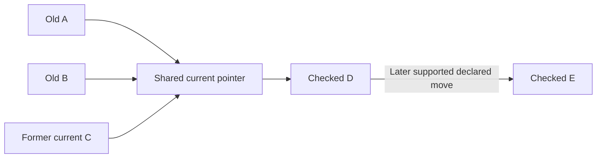

# Shared destination groups

Several old domains can share one current website and follow its later supported moves together. This is an **opt-in local mapping feature in extension version 0.3.0 or later**. It needs no backend, search key or registry account.

A group is a user-configured routing choice. An observed move remains source declared; it is not owner verification or a guarantee that content is safe. Use only destinations and compatible page-path policies you intend to follow.

## Set up several old sources

1. Open Web Switcher settings and use the manual form to map each old origin to the same checked **Current origin**. Origins are exact: protocol and subdomain matter. A and B may both point at C; each old source still needs its browser grant.
2. Choose each mapping's link behavior. **Keep its page path** retains a compatible public article path on the current domain; **Open the homepage** discards it. Queries and fragments are removed in either case. Sensitive or ambiguous links can require homepage-only confirmation.
3. On one saved card, choose **Follow destination moves**. This explicit action joins **all local mappings currently pointing at that destination** into the same group. Review that shared scope before enabling it. Alternatively, check **Follow future moves for all mappings to this destination** when saving a new manual mapping; it is off by default and creates or joins the shared group.
4. Grant access to the selected source and current destination if requested. New declared successors normally require an explicit next-origin permission action. If you want fully automatic checks across later HTTPS domains, first select the separate, unchecked **Allow future destination checks across HTTPS websites** option when saving/enabling shared following, and approve that broader browser grant. It does not enroll every website or prove any destination's identity. Leave it unchecked for individual-origin prompts.
5. Saved group cards show **Shared destination · follows declared moves**. Visit an enabled old alias, or choose **Check shared destination now** to check the current destination without opening an article.
6. If a check requests more access, use **Allow next shared destination check** in settings, or **Allow next destination check** on the routing page. Denial stops that check; an unchecked target is not opened.

If the old sources are already saved as separate fixed mappings to C, you do not need to delete/re-add them. Enable shared following on one of those cards. Existing mappings are not grouped merely by upgrading the extension.

## What happens across later moves

These letters represent origins you control or have checked. They are not a real public migration claim.

| Event | Shared current destination | Local aliases after a successful update |
| --- | --- | --- |
| You map A and B to C and enable following | C | A → C; B → C |
| A visit/check observes a supported C → D move and checks D | D | A → D; B → D; C → D |
| C disappears; a later check observes D → E and checks E | E | A → E; B → E; C → E; D → E |

The group starts its check at the current destination's root. It does not have to contact every retired source. After C → D has been accepted, a later A/B visit checks D; C can be gone without preventing a supported D → E update. Every accepted change updates the group's mappings in one configuration commit and flattens the aliases directly to the checked terminal. The former current address becomes another old alias, subject to the same validation and capacity limits.

For a mapping with page-path preservation, opening `https://old-a.example.org/articles/42` can therefore open `/articles/42` on the newly checked current origin. A homepage mapping still opens only that origin's homepage. The destination must serve the same path; changing a hostname cannot reconstruct a missing article or transfer cookies/login state.

Checks run **when you visit a group alias or explicitly request a check while the browser is running**. This feature does not periodically poll the Internet, update with the browser closed or promise immediate detection between visits. Browsing the current site's own direct redirect may work normally; the shared pointer is refreshed on the next group visit/check.

## Evidence used to advance the pointer

The group uses the same bounded direct continuity engine as source-only discovery: supported HTTP redirects, short Refresh declarations, inert HTML move metadata, explicit successor links and an advertised same-origin project pointer. Remote JavaScript is not executed by the probe. Ordinary matching names, logos, content similarity, arbitrary links or search rank do not authorize a group update.

Valid origin-only continuity memory can bridge a qualifying vanished **known** intermediate domain. Learned edges expire after at most seven days from their latest observation, and the terminal must be checked now. If the current address is dead and no supported fresh or remembered successor is available, the extension cannot invent the next domain. Use the separate **Search public sources** flow to investigate candidates; its suggestions remain unverified and do not silently rewrite a group.

A healthy current origin with no supported move stays current. Conflicts or failure to establish a checked current origin stop automatic routing rather than fall back to an unchecked destination.

## Controls and consent remain individual

- **Stop following destination moves** stops automatic updates for the entire local group. It retains the latest saved destination mappings; their ordinary static path/expiry rules still apply.
- An alias's enabled state, path policy, creation time and expiry remain its own. Updating C → D does not enable a paused alias or renew any expiry. A derived former-current alias uses existing group consent; it is not a new period of consent.
- Global pause stops switching and shared checks. A revoked origin grant stops the corresponding check/navigation. Changing settings while a check is in flight invalidates the old result.
- Local group identity is separate from signed registry family identity. Signed-history reservations at an alias, group seed, current address, attempted origin, intermediate or terminal block the weaker automatic path. Expired/withdrawn signed policy does not become permission for an unsigned group update.
- Normal loop protection is shared across the group's aliases, so a destination cannot avoid it simply by returning through another old source. Sensitive URL rules and the bounded rapid-switch guard still apply.

## Bounds, conflicts and fixed mappings

The existing limit is **50 local mappings**, including derived former-current aliases. Advancement that would exceed the limit stops without partly changing the group. Remove obsolete local entries after review before trying again; do not rely on a partial update.

Mappings remain flattened: each old origin points directly at the checked current terminal. A destination that would return to an old alias or introduce a loop is rejected. If a separate fixed mapping outside the group depends on the former current address, turning that address into a derived alias can create a forbidden static chain. Reconcile that explicit fixed choice or opt the relevant mappings into the shared group; the extension will not silently change an unrelated static decision.

Origins are not merged by a shared name or suffix. Distinct subdomains are distinct sources. A group is joined by the explicit local shared-destination action, not by a global domain registry or cross-user lookup.

## Local storage, export and updates

Membership is stored in each local mapping's `followOrigin` seed, with a shared `destinationOrigin`. The seed identifies the local group even after its current destination moves. It is not a signed family identifier. Existing origin-only continuity memory stores the supported observations; probe bodies and original private URL parts are not persisted as group evidence.

**Export settings** includes the manual mappings and optional local follow seeds. Review those choices when importing; imports do not manufacture browser host grants, provider credentials, signed authority or learned graph history. Protect the exported file because even origin pairs can reveal interests.

For an unpacked installation, export settings first, replace built files in the **same installed folder** with a successful 0.3.0-or-later build, and click **Reload** at `chrome://extensions`. Close old extension pages and reopen the original website URL. Do not remove the installation merely to update it. Version 0.3.0 uses the same declared permissions as 0.2.2; the existing `webNavigation` permission may display Chrome's browsing-history warning, but unrelated browsing history is not retained. See the [installation/Store guide](CHROME_INSTALL_AND_STORE.md), [privacy policy](privacy.html) and [architecture](ARCHITECTURE.md).

Code and controlled test fixtures establish the implemented mechanics, not the live correctness of a public domain relationship. Consult the exact revision's [implementation evidence](IMPLEMENTATION_STATUS.md) and PR checks before distributing a build.
