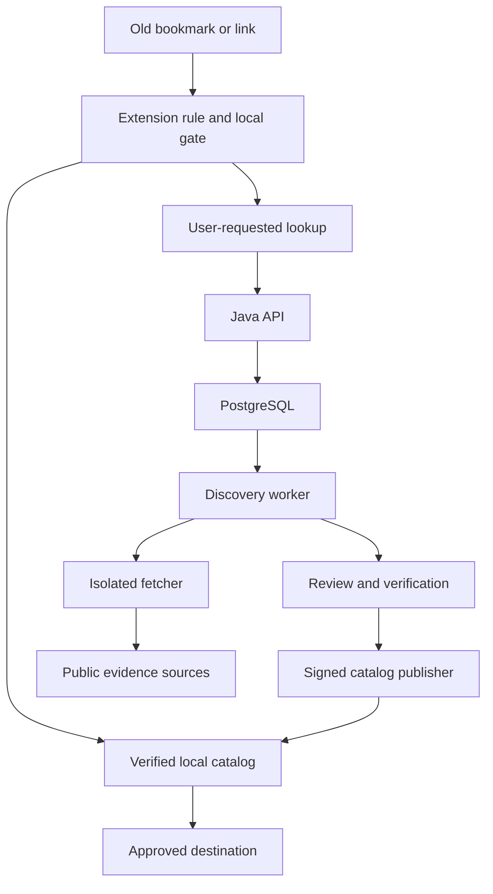

# Web Switcher — Complete Research, Product and Engineering Plan

**Prepared for:** Satyam Sahu  
**Research date:** 25 October 2026, UTC  
**Implementation repository:** https://github.com/satyamsahu40678/web-switcher  
**Suggested repository path:** `docs/WEB_SWITCHER_PLAN.md`  
**Document status:** Research-backed plan with an experimental local-routing prototype; the production MVP is not released.
**Continuation update:** 26 October 2026, Asia/Kolkata. See `docs/PROTOTYPE_STATUS.md` for executed checks and open browser gates.  
**Working product promise:** “Follow the website, even when its address changes.”

This document defines the proposed product, existing alternatives, novelty strategy, extension, frontend, Java backend, data, discovery, security, infrastructure, costs, testing, deployment, operations and implementation backlog. Implementation checkboxes are checked only when the complete item has supporting evidence; partial prototype coverage remains unchecked. Recommendations, numerical targets, budgets and research hypotheses are proposals unless explicitly identified as observed facts.

## Contents

1. [Decision and current repository](#1-decision-and-current-repository)
2. [Problem, examples and boundaries](#2-problem-examples-and-boundaries)
3. [Research and existing solutions](#3-research-and-existing-solutions)
4. [Novelty strategy](#4-novelty-strategy)
5. [Scope and requirements](#5-scope-and-requirements)
6. [User experience and spider theme](#6-user-experience-and-spider-theme)
7. [System architecture and technology](#7-system-architecture-and-technology)
8. [Extension implementation design](#8-extension-implementation-design)
9. [Discovery and verification](#9-discovery-and-verification)
10. [Site Passport and signed registry](#10-site-passport-and-signed-registry)
11. [Backend modules and database](#11-backend-modules-and-database)
12. [API and message contracts](#12-api-and-message-contracts)
13. [Frontend implementation](#13-frontend-implementation)
14. [Security and privacy](#14-security-and-privacy)
15. [Reliability and operations](#15-reliability-and-operations)
16. [Testing and research evaluation](#16-testing-and-research-evaluation)
17. [Repository and local development](#17-repository-and-local-development)
18. [Deployment and infrastructure](#18-deployment-and-infrastructure)
19. [CI/CD and browser-store release](#19-cicd-and-browser-store-release)
20. [Resources, capacity and costs](#20-resources-capacity-and-costs)
21. [Roadmap and release gates](#21-roadmap-and-release-gates)
22. [Complete implementation backlog](#22-complete-implementation-backlog)
23. [Risks, decisions and handoff](#23-risks-decisions-and-handoff)
24. [Source register](#24-source-register)

## 1. Decision and current repository

**Recommendation: proceed with a scoped proof of concept, then a verified-registry MVP.** There is a useful engineering project here. Ordinary redirection is established; trustworthy discovery of a changed website address is the difficult part and the opportunity for differentiation.

The feasible promise is: **automatically route supported, verified old addresses to the currently approved address, and help investigate unsupported addresses without guessing silently.** A guarantee that every dead link on the internet will always find the correct live replacement is not feasible. Some sites disappear, have no replacement, split into multiple organizations, or are copied by unrelated operators.

| Observed repository state | Finding |
| --- | --- |
| Repository | `satyamsahu40678/web-switcher`, public |
| Default branch inspected | `main` |
| Baseline commit | `075bc000eaf203f912c4e610b3f7fbc7746681e9` |
| Files at root | `README.md` only |
| README | Describes an extension that switches an outdated link to the correct link |
| Existing application, tests, CI, infrastructure or license file | None visible in the inspected tree |
| Changes made during the initial planning work | None; the initial study was delivered as a document and experiment bundle |
| Continuation work | Experimental local-routing source, tests, CI and documentation on `feat/local-routing-prototype`; see the progress record |

Repository findings come from authenticated GitHub metadata, directory and file reads. Recheck the branch before implementation because it can change. The Java/React technology choices below are proposed defaults for this project, not a stated user preference or a description of pre-existing code.

### 1.1 Delivery sequence

1. Prove browser navigation, permission, expiration and URL-handling behavior on controlled domains.
2. Ship a useful extension with manually configured mappings and a small reviewed registry.
3. Add a Java service that monitors registered site families and suggests migrations.
4. Add Site Passport owner signatures and a dated migration graph.
5. Evaluate discovery, abuse resistance and privacy before broad automatic coverage.

Do not make AI, broad crawling, a large community or universal owner adoption prerequisites for the first useful release.

### 1.2 Continuation: bounded routing prototype

The continuation adds an experimental unpacked MV3 extension with explicit local mappings, spider/thread settings UI, a validating route page, expiry/pause checks, source permissions, generation checks and bounded origin-only receipts. Its small packaged JavaScript implementation is a P0 feasibility artifact; the TypeScript/React/WXT application and Java backend remain planned. The prototype neither discovers new domains nor establishes operator identity.

The original local HTTP/signature evidence is preserved. All 26 new pure routing tests and syntax/package checks passed locally. Chromium was downloaded, but local execution was denied a required process socket and the environment rejected elevated execution. A read-only-token GitHub Actions workflow is prepared for actual browser validation. It has not run: the connected GitHub API rejected branch creation with HTTP 403, and ordinary Git push had no authenticated credentials. The prototype is committed locally and supplied as a source/extension/patch handoff; no remote branch or PR was created. Current results, known gaps and release gates are maintained in `docs/PROTOTYPE_STATUS.md`; the original failed browser attempt below remains a historical observation.

## 2. Problem, examples and boundaries

### 2.1 The user's example

The user supplied these older addresses and described a later address. They are recorded as an **illustrative migration family supplied by the user**, not independently verified statements about present ownership, safety, availability or chronology.

| User-supplied older hostname | User-supplied later hostname |
| --- | --- |
| `vegamovies.vodka` | `new1.vegamovies.lease` |
| `vegamovies.menu` | `new1.vegamovies.lease` |
| `vegamovies.gt` | `new1.vegamovies.lease` |
| `new2.vegamovies.futbol` | `new1.vegamovies.lease` |

The intended experience is that opening any known older bookmark resolves to the verified current member of the same site family. Production data must establish that relationship; matching the string “vegamovies” is insufficient. These examples must not become trusted production seed entries merely because they appear in this plan. Use owned test domains and reserved `.test`/`.example` names for demonstrations and tests.

### 2.2 Three separate questions

| Question | Meaning | Why it matters |
| --- | --- | --- |
| Is it reachable? | DNS, TLS and HTTP work from a particular location | A phishing copy can also be reachable |
| Is it the same site? | Historical identity and authorization connect the domains | This determines whether switching is justified |
| Is this the right page? | The old path corresponds to a particular new page | A working homepage does not repair every deep link |

Keep reachability, identity, content similarity and threat checks separate throughout the schema, UI and evaluation. A successful HTTP response is never an identity certificate. A “not listed as malicious” response is never a safety guarantee.

### 2.3 Terminology

| Term | Definition |
| --- | --- |
| Site family | Stable logical website identity, independent of a hostname |
| Alias | An exact historical hostname associated with a family during an interval |
| Endpoint | Approved origin that can currently serve the family |
| Migration | Dated, evidenced change from one endpoint to another |
| Mirror | Concurrent alternative endpoint; not necessarily a migration |
| Candidate | Unverified potential endpoint |
| Evidence | Source-backed observation supporting or contradicting a relationship |
| Passport | Optional owner-signed continuity record |
| Registry | Reviewed, versioned mapping data distributed to extensions |
| Gate | A packaged extension page that validates the decision before navigating |
| Abstention | Explicitly declining to choose a destination when evidence is inadequate |

### 2.4 Operating boundaries

- Browser navigation only: the extension does not change operating-system DNS or other applications.
- HTTP/HTTPS top-level GET navigation is the initial supported surface. Do not replay POST requests, downloads, form submissions, API calls, iframes or WebSocket traffic.
- Credentials, cookies, local storage and logged-in sessions do not migrate across domains. Authentication may be required again.
- DNS errors, HTTP 404, temporary outages, expired certificates, captive portals and regional blocking have different meanings. Do not collapse them into “website moved.”
- No automated search-engine replacement, affiliate substitution, proxy/VPN functionality, certificate-warning suppression or access-control bypass.
- Domain migration assistance is site-agnostic. Launch examples should demonstrate legitimate, owner-controlled migrations and documentation moves.
- Existing bookmarks keep their stored URLs unless the user separately previews and approves a bookmark-update operation.

## 3. Research and existing solutions

### 3.1 Method and confidence

Research covered browser stores, project-owned repositories, an ACM conference publication, current Chrome/Edge/Mozilla documentation, identity protocols, security references and deployment-provider documentation. Product comparisons describe published capabilities; the competing extensions were not installed or benchmarked. This is a dated engineering landscape review, not an exhaustive proof of absence or a patent novelty assessment.

Search themes included automatic new-domain discovery, redirect-rule extensions, broken-link recovery, mirror-instance registries, website identity continuity, signed mutable pointers and Manifest V3 navigation limits. Primary sources are linked in section 24. No live claim is made that the example destination is currently the correct site.

### 3.2 Closest alternatives

| Existing work | Published capability | Relationship to Web Switcher | Remaining distinction |
| --- | --- | --- | --- |
| **Redirector** [R01] | User-defined URL rules using regex/wildcards | Direct prior art for automatically rewriting old URLs | User supplies the mapping; general independent migration discovery is not its documented purpose |
| **Dynamic Domain Redirector** [R02] | Configured source/target domains, path preservation, update open tabs | Very close to the simplest version of this idea | Its published setup requires the user to configure the destination |
| **URL Redirector, Chrome MV3** [R03] | Rule management and DNR-based old-domain redirects | Confirms an MV3 redirect-only product already exists | Documented mappings are configured rather than independently identity-verified |
| **LibRedirect and its instance registry** [R04][R05] | Redirect supported services to alternative frontends; generated instance data | Strong precedent for extension + maintained endpoint catalog | Alternative frontends are a different relationship from the original site's domain continuity |
| **Redirect Path / Link Redirect Trace** [R06][R07] | Inspect redirect chains and related navigation signals | Useful diagnostics and evidence sources | Observing existing redirects does not recover a missing redirect after the old host disappears |
| **Wayback Machine extension** [R08] | Offer archived copies after error conditions | Prior art for helping users recover from broken links | Historical snapshots are not a verified currently operating replacement |
| **FABLE, IMC 2023** [R09][R10] | Find new URLs of moved pages by learning URL transformations | Closest research prior art for automatic broken-link relocation | Web Switcher would emphasize browser deployment, cross-domain identity continuity, temporal trust and safe abstention |
| **Memento** [R11] | HTTP framework for accessing historical resource states | Relevant to historical evidence and archive fallback | Does not itself establish the current owner-authorized live address |
| **IPNS** [R12] | Signed mutable pointers associated with stable key-based names | Prior art for stable identity with changing destinations | Web Switcher targets conventional HTTP bookmarks and nonparticipating sites too |
| **W3C DIDs / AT Protocol identity** [R13][R14] | Persistent identifiers, keys, service locations, bidirectional handle relationships | Prior art for identity separate from a domain | The proposed contribution is their application and evaluation in legacy browser-link recovery |
| **Chrome PWA origin migration** [R15] | Published Chrome 150 feature for owner-coordinated, same-site installed-PWA migration | Important recent adjacent platform capability | Ordinary cross-TLD bookmarks and uncooperative/dead source sites are outside the described same-site PWA workflow |

**Finding:** several components already exist, and FABLE addresses a substantial part of automatic relocation. I did not find a verified, general consumer product in this review that demonstrates the entire proposed combination for arbitrary websites. That is a scoped research finding, not a claim that no such product exists.

### 3.3 Build, borrow or reuse

- Implement the product and trust policy independently; study existing redirectors for UX and browser behavior.
- Use established cryptography, parsers and browser APIs. Do not invent cryptographic primitives.
- Treat FABLE as research inspiration and an evaluation baseline, not a drop-in production service. Its public README is minimal; a full reproducibility and dependency review is still required.
- Do not copy project code or redistribute registries until the applicable licenses and data terms have been reviewed. Public GitHub availability is not a blanket reuse license.
- Search integration needs a currently available provider. Microsoft's traditional Bing Search APIs were retired on 11 August 2025; older recovery code may require a new search adapter. [R16]

### 3.4 Competitive positioning

Recommended positioning: **“A browser companion that follows verified website migrations and explains why it trusts the new address.”**

Useful differentiators are independently inspectable evidence, readable domain history, explicit freshness, revocation, local user control, owner-assisted continuity and measured resistance to impostor domains. The spider theme supports the idea of following a thread through changing addresses; it is visual differentiation, not technical novelty.

## 4. Novelty strategy

### 4.1 Proposed contribution

Build an **evidence-based website continuity system** whose output includes a destination, a reason, a validity window and an abstention decision. Evaluate whether temporal continuity and owner proofs improve recovery without increasing unsafe switches.

The proposed research question is:

> Can combining a dated migration graph, optional owner proofs and local navigation safeguards recover more correct live destinations at a fixed false-switch rate than static rules or search-and-similarity recovery?

This is a research hypothesis. No results have been measured. Stable identities, signatures, graphs, transparency logs and content matching all have prior art; the combination, implementation details and measured outcome must justify any stronger novelty claim.

### 4.2 Five feature strategies

| Strategy | Concrete design | Value | Novelty assessment | Stage |
| --- | --- | --- | --- | --- |
| **Site Passport** | Stable family ID; owner key; signed sequence of approved origins and revocations | Continuity survives loss of an old domain if trust was established earlier | Application of existing identity/signature ideas; not a new cryptographic invention | P4 |
| **Temporal migration graph** | Time-bounded domain bindings and migration edges with independent evidence and conflicts | Handles repeated moves, concurrent mirrors and re-registered domains | Candidate systems contribution when evaluated against simpler histories | Model in P2; research in P4 |
| **Explanation attached to every switch** | Structured evidence codes, dates, reviewer state, target freshness and visible “why” view | Users and reviewers can inspect decisions | Strong product differentiation; broad concept already established | P1 onward |
| **Local continuity memory** | User-selected family subscriptions, locally confirmed destinations and local rollback history | Personal recovery works without uploading browsing history | Integration/UX contribution; evaluate privacy and recovery trade-offs | P1–P3 |
| **Abstaining, cost-aware discovery** | Prefer cheap trusted sources; search only on gaps; stop if evidence is weak | Reduces cost and exposure to clones | Research candidate if it improves coverage at a controlled risk budget | P3–P5 |

### 4.3 Site Passport adoption strategy

Start with websites whose operators want migration support: personal sites, project documentation, community forums and organizational rebrands. Provide a CLI that generates a key and signed record, an owner guide, and a simple status page. Offer registry-curated mappings for sites that do not participate.

Use an experimental endpoint such as `/.well-known/web-switcher.json`, explicitly marked as a project convention rather than an established standard. Review well-known URI registration requirements before proposing it as a public interoperable specification. [R17]

Never require a blockchain, a token or a new DID method. Reuse the design lessons from DIDs, IPNS and AT Protocol; provide adapters later only where they solve a real interoperability need.

### 4.4 Trust bootstrap is the hard part

An attacker can sign a manifest for an attacker-owned domain. A valid signature proves control of a key, not that it belongs to the original website.

Establish the family-to-key binding while the old origin is still trusted, through an owner-control challenge plus reviewed continuity evidence. After that, an update signed by the pinned key can preserve continuity. If the old site is already dead and no prior trusted key or sufficient independent evidence exists, remain in suggestion/manual-review mode.

Do not silently merge two site families just because they share a logo, public key claim, hosting provider or name. An ownership transfer is a separate reviewed event.

### 4.5 Research experiments and falsifiable claims

| Experiment | Comparison | Primary measurement | Failure criterion |
| --- | --- | --- | --- |
| E1: migration graph | Current mapping only vs full dated evidence graph | Correct recovery at equal false-switch rate | Added complexity does not improve held-out results |
| E2: owner continuity | Curated evidence vs previously pinned owner proofs | Impostor rejection and continuity after old-domain loss | Signatures increase false confidence under key compromise/bootstrap attacks |
| E3: abstention | Always select top candidate vs confidence-gated refusal | Risk–coverage curve and harmful-switch count | Higher coverage comes from accepting more impostors |
| E4: adaptive discovery | Fixed search/crawl schedule vs change-triggered scheduling | Cost per verified migration and detection delay | Cost saving materially worsens stale routing |
| E5: local-first delivery | Per-navigation lookup vs periodic signed catalog | Server visibility, latency and bytes per user | Privacy mode leaks host/path history or becomes unusably stale |
| E6: explanations | Plain destination vs concise evidence/history | Understanding, correction rate and time to recover | Users mistake “verified identity” for a guarantee of safe content |

Use family-level and time-based train/test splits, predeclare metrics, retain negative examples and publish failure cases. Any optional learned ranker is compared with deterministic baselines. Do not advertise “AI-powered,” a percentage accuracy, or “first-ever” before evidence supports it.

### 4.6 Practical release choice

Ship evidence/history and local-first operation first. Add owner proofs as the flagship technical feature after the basic extension works. Broad crowdsourced observation, learned path recovery, privacy relays and externally witnessed transparency belong in later experiments. These must not delay the initial useful release.

## 5. Scope and requirements

### 5.1 Initial audience and success criteria

Primary users keep bookmarks to moving sites. Secondary users maintain documentation, communities or websites that are migrating. A third role, registry reviewer, maintains public mapping quality.

Proposed pilot: 20 consenting testers, 20–50 verified families, no more than 200 enabled alias rules per installation. These are initial operating limits, not estimates of the total addressable market.

| ID | Requirement | Acceptance condition | First stage |
| --- | --- | --- | --- |
| F01 | Add a local mapping | Preview exact source/target, validation and saved scope | P1 |
| F02 | Open a known old bookmark | With permission and current verified data, arrive at the selected approved endpoint | P1 |
| F03 | Follow repeated migrations | A→B→C resolves to current C without visiting B | P2 |
| F04 | Explain a decision | Show origin, target, evidence category, verification time and expiry | P1 |
| F05 | Preserve supported page paths | Only under an explicit compatible path policy | P1 |
| F06 | Protect sensitive URL data | Default query/fragment removal; no remote full-URL lookup | P1 |
| F07 | Pause, undo and ignore | User can bypass once or disable a family without loops | P1 |
| F08 | Work without an account | Core extension and signed public catalog require no login | P1 |
| F09 | Handle unknown links | Return no verified match; allow explicit lookup/report | P2 |
| F10 | Monitor known families | Scheduled bounded health and continuity checks | P3 |
| F11 | Review suggestions | Candidate cannot become a published mapping without required gates | P2 |
| F12 | Expire and revoke data | Gate refuses expired, withdrawn or incompatible decisions | P2 |
| F13 | Handle permission denial | Manual mode remains usable with clear instructions | P1 |
| F14 | Chrome and Edge packages | Both pass their own navigation/permission checks | P1/P2 |
| F15 | Export/import local settings | Strict versioned schema, preview and conflict handling | P1 |
| F16 | Site owner continuity | Enroll, sign a move, rotate/revoke keys and show proof status | P4 |
| F17 | Optional bookmark repair | Preview diff, backup and rollback before explicit apply | P4 |
| F18 | Firefox build | Separate manifest and behavioral verification | P5 |

### 5.2 Nonfunctional targets

These are acceptance targets to measure, not current performance claims.

| Attribute | Pilot target |
| --- | --- |
| Local verified routing | p95 extension overhead ≤150 ms warm, ≤400 ms cold, excluding destination load; measure gate flash separately |
| Registry lookup | p95 ≤500 ms under a stated 50 requests/second test on the selected deployment |
| Cold discovery | Asynchronous; never hold ordinary navigation open for a long crawl |
| Routine browsing network cost | Zero per-navigation server requests for locally known mappings |
| Safety fixture suite | Zero automatic switches to malicious/ambiguous fixture destinations |
| Availability | Target 99.5% pilot API availability; local valid catalog remains useful during outages |
| Accessibility | WCAG 2.2 AA target, keyboard navigation, screen-reader labels, reduced motion |
| Resource use | No persistent polling loop in the extension; bounded catalog and logs |
| Deletion | User can clear local data immediately; server report deletion process documented |
| Maintainability | Versioned contracts, migrations, documented release/rollback procedure |

### 5.3 Explicitly deferred

Safari packaging, mobile browser support, universal automatic site enrollment, semantic deep-page matching, cross-device accounts, large community reputation systems, enterprise policies and analytics are deferred. They have roadmap entries, not implicit v1 commitments.

## 6. User experience and spider theme

### 6.1 Visual direction

Use an original geometric spider/thread identity. Avoid licensed superhero artwork or copied brand assets. The metaphor is a thread connecting old and new addresses.

| Design element | Proposed specification |
| --- | --- |
| Base theme | Deep ink background `#0B1020`, panels `#151E32`, text `#F4F7FF` |
| Accent | Cyan `#67E8F9`; violet `#A78BFA` for selected controls |
| Status | Green verified, amber needs review, red blocked; always pair with text/icon |
| Typography | Bundled/system sans serif; monospace only for hostname details |
| Popup | About 380 px wide; viewport-aware height; primary action visible without scrolling |
| Logo | Minimal spider or woven link, legible at 16/32/48/128 px |
| Background pattern | Very subtle web lines, no interference with reading |
| Motion | Short thread transition; respect `prefers-reduced-motion`; no crawling animation by default |
| Light mode | Equivalent readable contrast; follow OS with an override |

Do not present a confidence score as a percentage of safety. Prefer labels such as “Owner verified,” “Registry reviewed,” “User configured,” “Candidate only” and “Verification expired.”

### 6.2 Screens and behavior

| Surface | Required content and actions |
| --- | --- |
| Onboarding | One-sentence purpose; choose manual or selected-sites automation; explain host access; optional catalog opt-in |
| Popup | Current host, family, approved destination, status, last check, “Open current site,” pause, why, settings |
| Route gate | Automatic continuation for eligible known mappings; otherwise reason and safe choices; no advertising |
| Options | Families, aliases, local mappings, privacy, permissions, import/export, retention, troubleshooting |
| Migration history | Ordered dated moves; separate mirrors; evidence/source links; accessible list alternative to graph |
| Unknown-site helper | “No verified replacement found”; explicit search/report/manual mapping, never fabricated success |
| Report form | Source host, proposed host, category, optional evidence URL; preview what will be transmitted |
| Admin review | Candidate queue, evidence disagreement, probe history, approvals, publish/revoke, audit trail |
| Owner portal | Domain challenge, passport setup, destination verification, key rotation/recovery instructions |
| Public website | Product explanation, supported behavior, screenshots, install links, privacy, help, owner guide, status |

### 6.3 Main journeys

1. **Known alias:** user enables a family → grants its exact source hosts → opens old bookmark → gate validates local data → navigates to current origin → popup records a local receipt.
2. **Unknown host:** user opens the popup → chooses lookup → sees the exact hostname sent → receives verified result, candidates or unknown → grants source permission only if choosing automatic support.
3. **Candidate discovered:** backend stores candidate → reviewer inspects evidence → confirms or rejects → new signed bundle distributes approved mapping.
4. **Wrong destination:** user pauses family or reports → local routing stops immediately → report enters moderation → operator can withdraw the mapping globally.
5. **Owner moves again:** owner signs next sequence → destination challenge passes → reviewer/policy checks continuity → catalog changes current endpoint; all eligible historical aliases point directly to it.
6. **Offline or expired catalog:** valid cached decisions can continue until their validity limit; expired entries show a prompt and require manual choice or refresh.

“Undo” means suppress the extension for that source/family and attempt the original URL. It cannot force a live server to stop issuing its own redirect. Explain that distinction in help.

## 7. System architecture and technology

### 7.1 Component map



Data flows from untrusted evidence through verification and review before becoming routable configuration. The extension never executes backend-supplied code. The site family graph starts as relational tables; a graph database is unnecessary at pilot scale.

### 7.2 Recommended stack

| Layer | Selection | Reason / boundary |
| --- | --- | --- |
| Extension | TypeScript, WXT, React, Manifest V3 | Typed browser code, shared build system; WXT does not eliminate browser differences [R18] |
| Styling | CSS variables and small reusable components; optional Tailwind | Theme consistency without heavy runtime UI dependencies |
| Public/admin UI | React + Vite; same UI primitives | Admin can be served by Spring under the API origin |
| API | Java 21 LTS, Spring Boot stable 4.1.x line | Mature typed backend with scheduling, validation and observability; pin supported patch and dependency compatibility at kickoff [R19] |
| Backend structure | Modular monolith with API and worker runtime roles | Simple deployment while isolating untrusted fetching |
| Database | PostgreSQL, initially supported major 17 or newer verified with host | Relational integrity, JSONB evidence payloads and durable job queue |
| SQL/migrations | Spring JDBC or JPA consistently; Flyway | Explicit data integrity and repeatable schema changes |
| HTTP/HTML processing | Apache HttpClient with controlled DNS/connect path; jsoup | Bounded static fetching; no general browser automation initially |
| Scheduler | PostgreSQL leased jobs + Spring scheduling | No Redis/Kafka requirement for the pilot |
| Search | Brave Web Search adapter, optional and budgeted | Candidate generation only; keep provider replaceable [R20] |
| Threat lookup | Google Web Risk Lookup adapter or reviewed equivalent | Server-side candidate screening; fail to unknown on provider failure [R21] |
| Crypto | JWS ES256 using maintained Java library and browser Web Crypto | Cross-language signature verification without custom cryptography [R22] |
| Tests | Vitest, React Testing Library, Playwright; JUnit, Testcontainers, WireMock | Unit, integration and real browser behavior |
| Packaging | pnpm workspace + Maven wrapper; Docker multi-stage builds | Reproducible frontend/backend builds |
| CI | GitHub Actions | Checks, immutable images and extension release artifacts |
| Initial hosting | One 4 GiB Linux VM, Docker Compose, Caddy, off-host backups | Concrete inexpensive pilot; accept single-host availability limits |
| Metrics | Micrometer/OpenTelemetry-compatible instrumentation, structured logs | Redacted diagnostics; avoid building a separate analytics product |

The documentation observed during research lists Spring Boot 4.1.2 and WXT 0.21.4. Treat these as the research snapshot, not permanently correct patch pins. Verify stable versions and plugin compatibility before scaffolding. Use a supported Node LTS that satisfies the selected WXT toolchain and record it in the repository.

### 7.3 Why Java, and where Python could fit later

Use Java for API, registry, moderation, jobs and first-pass discovery. This keeps the core backend in one runtime. An all-TypeScript service is a reasonable alternative if the implementation team prefers it; neither language determines discovery quality. Introduce a separate Python evaluation service only if a later ranking experiment materially benefits from scientific libraries. No Python service, vector database, LLM, GPU or Kubernetes is required for MVP.

### 7.4 Trust boundaries

1. Browser UI and local catalog: only packaged logic and validated data.
2. Public API: untrusted input and anonymous traffic; never exposes raw network-fetch capabilities.
3. Admin surface: authenticated, role-limited mutations and immutable audit records.
4. Fetcher: treats all external pages as hostile; no database, signing or cloud credentials.
5. Publisher: sees approved records; signing key unavailable to public API and fetcher.
6. External providers: receive only the specifically disclosed public host/query data needed for their role.

## 8. Extension implementation design

### 8.1 Current browser facts that constrain the design

Chrome's DNR API applies declarative rules, including redirects. Redirect rules require host access. Dynamic redirect rules fall under the lower unsafe-rule allowance; the larger safe-rule allowance is not a universal redirect budget. Dynamic rules persist across restarts and updates; regex rules also have their own limit. DNR cannot fetch a backend verdict during a match and has no per-rule time-to-live. [R23]

Chrome MV3 background service workers can terminate when idle; state must survive restarts. `webNavigation` reports navigation events and errors but is not an HTTP status-code classifier. `webRequest` supplies network-level status observations; ordinary MV3 extensions do not get general blocking `webRequest` control. [R24][R25][R26]

These facts favor local routing and asynchronous catalog refresh rather than crawling when the user clicks a link.

### 8.2 Permission model

| Permission/capability | Initial choice | Purpose |
| --- | --- | --- |
| `storage` | Required | Settings, verified catalog and bounded local receipts |
| `activeTab` | Required | Inspect current tab when the user invokes the popup |
| `declarativeNetRequestWithHostAccess` | Required | Routing on hosts the user has granted |
| `alarms` | Required | Opportunistic refresh; not a correctness clock |
| Registry/API host | Exact owned HTTPS origin | Retrieve signed catalog and explicit lookups |
| `optional_host_permissions` | HTTP/HTTPS patterns declared; request only selected exact origins | Add support for chosen source domains |
| `webNavigation` | Optional troubleshooting/failure detection | Observe selected navigation failures, discard unrelated events |
| `webRequest` | Optional later health/error feature | Observe HTTP status for granted source hosts |
| `bookmarks` | Optional later, requested at feature use | Preview and apply bookmark updates |
| `tabs` | Avoid broad permission unless demonstrated necessary | `tabs.update` itself does not require broad access to all tab metadata |
| `history`, `cookies`, `debugger`, `proxy`, native messaging | Not requested | Not needed for the core purpose |
| Content scripts / `scripting` | Not needed for MVP | No page-wide DOM inspection or script injection |

Declaring broad optional host patterns is not the same as receiving blanket access. Request permission from a user gesture, explain why it is needed, and keep manual mode after denial. New ungranted source aliases cannot silently become automatic. A new target does not inherently need host permission merely to navigate to it; request target access only if a feature actually inspects it. [R27]

The optional “all sites” mode is deferred until a demonstrated need and a clear store-review justification. Do not advertise universal interception while shipping selected-host permissions.

### 8.3 Route through a packaged validation gate

**Recommended production default:** DNR sends enabled aliases to a small packaged `route.html` page. That page validates the current local mapping and only then navigates to the approved HTTPS destination.

Why a gate: a direct persisted DNR redirect cannot inspect expiration, a newly paused family or time after laptop sleep. Cleanup alarms alone cannot guarantee that a stale rule will never fire. A gate can enforce those checks at use time, at the cost of a small visible transition. The cold-start and UX costs must be measured in P0.

The rule compiler uses exact-host matching, `main_frame`, GET-only matching, and an anchored regex. It passes a fixed alias/rule identifier plus the matched source URL into the local gate fragment; the gate obtains the destination exclusively from trusted local data, never from a `target=` parameter. Full URL material remains local and is not sent in a network request. DNR regex substitution and extension-resource redirection are supported primitives; their exact serialization and browser interactions require a spike. [R23]

**P0 must resolve:** percent encoding, query delimiters, source fragments, Unicode, very long URLs, redirects from clicked links versus address-bar navigation, browser back/forward behavior, and access to the packaged gate. Do not promise fragment preservation: network request matching may not preserve original fragment semantics. v1 intentionally removes fragments and defaults to dropping queries.

Expose only the minimal gate resource through `web_accessible_resources`, with packaged dependencies as required by the actual build. Its exposure may need broad initiating-origin patterns to support links from arbitrary pages; this does not grant host access, but creates an extension-fingerprinting surface. The page must be harmless when directly invoked by an arbitrary website, with no settings mutation, no external messages and no arbitrary-destination redirect. Test `use_dynamic_url` and browser compatibility rather than assuming it solves exposure. [R28]

If the gate spike fails URL fidelity or usability targets, ship manual/prompt routing while redesigning it. Do not silently replace it with an expiry-unsafe direct redirect and claim equivalent guarantees. A future direct fast mode needs a separately documented risk model and measured justification.

### 8.4 Gate decision algorithm

```text
on gate activation:
    parse a bounded source URL; accept only HTTP/HTTPS and allowed ports
    resolve the exact normalized hostname to the supplied alias identifier
    reject any mismatched alias, credentials, malformed or oversized input
    load current settings, catalog generation, policy and revocations
    stop if paused, bypassed, incompatible, ambiguous, stale or untrusted
    select current approved endpoint for that family and applicable region
    validate destination origin and local path/query policy
    enforce per-tab family loop guard and sensitive-route exclusions
    store a minimal local receipt and intended destination
    replace navigation with the destination using no-referrer behavior
```

Every error renders a useful message with retry, manual selection or bypass. Parsing failures never produce a partially constructed destination. Remote replies, if needed to refresh stale data, are subject to the same signature and schema validation as scheduled updates.

### 8.5 Routing and URL rules

| Input case | Required behavior |
| --- | --- |
| Exact approved alias | Resolve family and apply current verified mapping |
| Unlisted subdomain | Do not infer permission or family membership |
| `old.example.evil.example` | Must not match `old.example` |
| Username/password in URL | Refuse automatic transformation |
| Unicode hostname | Normalize consistently; compare ASCII IDNA form; show readable and ASCII forms on review |
| Trailing dot / default port | Canonicalize under explicit tested policy; reject nonstandard ports in production v1 |
| Path under `preserve` | Preserve encoding/case exactly when route is known compatible |
| Path under `prefix_replace` | Use bounded literal prefixes and a fixed target origin |
| Unknown path structure | Offer destination homepage; do not call this page recovery |
| Query string | Drop by default; per-family allowlist only for benign explicitly supported keys |
| OAuth/reset/signed URL, payment or account route | Require manual confirmation; never copy token-bearing data automatically |
| Fragment | Drop in v1 auto-routing; manual advanced preservation is deferred |
| Encoded slash, dot segments, backslash, `//` path | Reject ambiguous transforms or preserve only after round-trip validation; never create a new authority |
| GET download link | Excluded by family policy where known; automatic download-triggering paths are not supported |
| POST/form/API/subresource | Never redirect through this feature |
| Domain now belongs to another site | Disable automatic aliasing unless user explicitly pins historical family intent |

Source origin and path must be parsed with a URL library, not string replacement. Do not lowercase paths or decode/re-encode the whole URL. TypeScript and Java share canonicalization fixtures to detect parser differences.

### 8.6 Loops, undo and concurrent navigation

- Flatten published aliases to their selected terminal endpoint; do not make the browser follow A→B→C itself.
- Reject self-loops and cycles at publication and again locally. Date-bounded legitimate return migrations require explicit review, not a timeless cycle.
- Store per-tab, per-family attempts and navigation generation in `storage.session`; expire guards and delete closed-tab state.
- Allow at most one automatic family switch per attempt. If the destination returns to an old alias or fails, show the helper rather than repeat.
- “Visit original once” installs a higher-priority tab-scoped session allow rule, then navigates. Remove it after the intended navigation/timeout, and handle tab reuse.
- Before an asynchronous reply changes a tab, compare tab ID, latest navigation generation and current URL. Never hijack a tab after the user has moved elsewhere.
- Local storage and DNR updates are not one cross-system transaction. Stage a catalog generation, validate, atomically replace the DNR batch, then activate; the gate must reject generation mismatches and recover after interruption.

### 8.7 Catalog refresh and browser differences

Refresh on installation, startup, explicit refresh and a roughly hourly alarm with jitter. Throttle startup storms and honor ETags. A signature, expiry and monotonic sequence check matter more than alarm punctuality. Remove obsolete rules on permission revocation, family disable and schema migration.

Budget for 200 enabled regex aliases initially, with hard headroom below browser limits. Chrome documents 5,000 unsafe dynamic rules and 1,000 regex rules in relevant categories; inspect runtime capabilities and test the actual selected browser releases rather than assuming all Chromium forks behave identically. [R23]

Edge is a primary target, with separate packaging, store identity and acceptance checks. Firefox is a later port: its documented background behavior differs from Chrome's service worker model. WXT can generate browser-specific builds, but cannot erase behavioral differences. Safari and mobile require separate feasibility work. [R29][R30]

### 8.8 Failure detection

Known aliases can switch before the old server is contacted when DNR applies. Detection is not limited to waiting for failure. For unknown sites, optional navigation-error or HTTP-status features may suggest lookup, but they do not prove migration.

Do not inject into browser error pages. Use the extension popup or packaged helper. Distinguish `ERR_ABORTED`, offline mode, DNS resolution errors, TLS failures, HTTP 404/410, 403/challenges, 429 and 5xx. DNR may not affect responses fulfilled entirely by a website service worker; include a manual fallback and test this case. [R23][R25][R26]

## 9. Discovery and verification

### 9.1 Candidate pipeline

1. Start with a known family, explicit report or explicit hostname lookup; do not crawl the entire internet.
2. Consult existing approved aliases, owner records, migration evidence and public endpoint catalog.
3. Observe bounded HTTP redirect chains and migration announcements on already trusted sources.
4. If necessary, use a search API with public hostname/brand terms and tight candidate limits.
5. Normalize and deduplicate candidate origins before making network requests.
6. Probe DNS/TLS/HTTP safely; classify response and location-specific availability.
7. Collect independent continuity evidence; compare selected public content as supporting evidence.
8. Apply conflict, ownership, threat and freshness gates.
9. Save candidates and explanations; require review for unsigned/unestablished relationships.
10. Publish only approved data, then monitor for change and revoke when required.

All external HTML, search snippets and metadata are untrusted data. They cannot issue instructions to the verifier, reviewer assistant or publisher.

### 9.2 Evidence hierarchy

| Evidence | Role | Limit |
| --- | --- | --- |
| Previously pinned owner key signs a destination | Strong continuity evidence | Key compromise and enrollment errors remain possible |
| Verified destination control + trusted old-origin announcement | Strong corroboration | A compromised old host can lie; check prior history and independent sources |
| Stable independently authenticated organization channel | Corroboration | Account takeover, stale posts and lookalikes must be considered |
| Reviewed historical redirect plus current continuity evidence | Useful migration evidence | Open redirects and expired/re-registered sources are not sufficient |
| Matching public page structure/content | Candidate ranking | Clones can copy pages; rebrands can legitimately change content |
| Canonical tags, sitemaps and public links | Discovery clues | Site-supplied assertions, not proof of identity |
| DNS/IP/TLS certificate relationships | Operational clues | Shared hosting, CDNs and certificate issuance do not prove common ownership |
| Search position, similar domain name, copied logo | Weak clues only | Never sufficient for automatic routing |
| Multiple user reports | Queue priority | Sybil attacks and copied reports prevent treating vote count as proof |

Two sources that quote the same announcement are not independent. Record upstream provenance groups so duplicate evidence does not inflate confidence.

### 9.3 Decision policy

The following is a proposed policy, not a calibrated probability model.

| Decision | Required conditions | Client behavior |
| --- | --- | --- |
| `AUTO_ELIGIBLE` | Current valid catalog; granted source; opted-in family; established owner continuity or explicitly reviewed registry continuity; fresh reachable target; no conflict/threat/sensitive route | Continue through local gate |
| `CONFIRM` | User-owned local mapping, first use under selected mode, or additional URL/identity ambiguity | Show source and target; require user action |
| `CANDIDATE_ONLY` | Search/content evidence without sufficient continuity | Show suggestions, never install automatic rule |
| `UNKNOWN` | No candidate, expired data, inconclusive reachability or provider outage | Explain uncertainty and permit manual action |
| `BLOCKED` | Revoked key/mapping, known threat, prohibited target, detected conflict | Disable automatic routing and show reason |

Registry-curated approval and owner-signed approval are different trust classes. A solo maintainer cannot claim two independent reviewers. Before onboarding many public families, recruit a second reviewer for high-impact unsigned changes; until then keep that class confirmation-only where independent review is required.

An internal priority score may help rank a review queue. Do not let a weighted sum of weak signals cross the automatic-routing gate. If learned confidence is introduced, calibrate it on held-out families and still enforce hard exclusions.

### 9.4 Availability policy

- Prefer HTTPS; validate certificates normally. No silent downgrade after a TLS error.
- HEAD may disagree with GET. Use a bounded GET when needed; record redirect chain, status and content type.
- HTTP 200 with parked-domain or unrelated content is a conflict, not success.
- HTTP 403, 429 or a browser challenge is “inconclusive/challenged,” not proof of death.
- A server probe succeeding does not prove a user's network can reach the site. Record vantage region; do not automatically hop through unrelated mirrors after regional failure.
- Keep concurrent approved mirrors distinct from a sole canonical destination. Let the user choose a verified mirror if the selected endpoint is unavailable.

### 9.5 Initial crawl and refresh budgets

| Control | Proposed starting limit |
| --- | --- |
| Candidate origins per discovery job | 10 |
| Search calls per uncached discovery | 2, with a daily/global budget |
| Public sample paths per origin | 3, excluding account and token routes |
| Redirect hops per fetch | 5 |
| DNS/connect/read total budget | 15 seconds per bounded fetch, with smaller component timeouts |
| HTML body | 1 MiB decompressed maximum; separate compressed and decompression limits |
| Concurrency | 4 global fetches; 1 in flight per registrable domain |
| Host interval | At least 5 seconds between fetches; back off on 429/5xx |
| Negative discovery cache | Start at 6 hours; explicit reviewer refresh can bypass |
| Active-family probes | Every 6 hours; increased frequency only on signals/budget approval |
| Dormant families | Daily or weekly according to usage-independent priority |
| Discovery job lifetime | 2 minutes; retry at most 3 times with jitter; then dead-letter review |

Respect robots rules, source terms and provider limits; RFC 9309 defines robots behavior. Do not treat a robots policy as authentication or authorization. Use an identifiable crawler user agent and contact page. No login-wall or CAPTCHA bypass. [R31]

### 9.6 MVP seed-data process

Use controlled A/B/C test sites first. Then enroll consenting operators or documented migrations of public projects. Each seed needs an evidence record, identity/reachability classification, verification timestamp, expiry and a reviewer. Publish only approved hostnames, never private reports or full browsing URLs. Search discovery is optional: the useful initial catalog can be fully curated.

### 9.7 The linked-list theory: what works and what breaks

Your proposed “next, next, next” mechanism is a correct model for a **linear HTTP redirect chain**: an old server returns a `Location` pointing to its successor, and the client follows it. HTTP 301/308 and owner-maintained redirects already provide this mechanism. Google recommends long-lived migration redirects and updating links to reduce unnecessary hops. [R41][R42]

However, the pointer is normally stored on the old website. If A disappears before the client reads A→B, there is no `next` value to follow. A cached pointer may rescue previously observed moves, but a cache cannot discover an unobserved move by itself.

**Adopt the idea with two upgrades:** store the migration edges outside the retiring domains, and publish a verified direct alias-to-current lookup. Keep A→B→C as audit history while routing A directly to C. This is path compression over known, approved history; it reduces requests but does not create missing knowledge.

| Situation | Plain live chain | Stored immediate-next pointers | Stored history plus approved current endpoint |
| --- | --- | --- | --- |
| A, B and C all work | A→B→C works | Works | Direct C works |
| A dies after A→B was learned | Fails at A | Can start at B | Can resolve C if current relationship is known |
| A and B die after full history was learned | Fails | Fails if only A→B survived | Previously approved A→C can work until its validity expires |
| C moves to D, then dies before anyone observes C→D | Fails | Fails | Needs an independently obtained update; cannot infer D from history alone |
| A is re-registered by a different operator | May follow an unrelated redirect | May trust obsolete ownership | Time-bounded alias and conflict policy can stop the automatic switch |
| Two approved mirrors or a site splits | A single `next` is inadequate | A single `next` is inadequate | Represent a graph and make selection/ambiguity explicit |

RFC 5829 already defines predecessor/successor/latest link relations for versioned resources. Those are relevant prior art for a navigable history, not a deployed universal domain-migration registry. WebFinger similarly provides entity metadata discovery, but needs an available discovery authority and an application-specific trust policy. [R43][R44]

### 9.8 Wider solution search: what to include and exclude

| Mechanism explored | What it contributes | Why it cannot solve the full problem alone | Decision |
| --- | --- | --- | --- |
| Live HTTP 301/308 | Explicit next destination | Old host must still respond; redirect can be malicious | Collect as evidence |
| Meta refresh / JavaScript redirect | Client-side forwarding | Requires loading untrusted content; can be personalized or deceptive | Later sandboxed observation only |
| Local browser redirect cache | Previously observed pointers | Device-specific, stale and not generally exportable as a reliable registry | Do not depend on browser internals |
| Extension-maintained history | Observed edges independent of old host | Cannot discover unseen successors; old evidence can become stale | Core feature, with expiry |
| Canonical, sitemap, public links | Candidate hints | Assertions and content location, not owner continuity | Supporting evidence |
| DNS CNAME / TXT | Owner-published association or discovery data | Records can vanish with the old domain; DNS aliasing does not itself rewrite the browser's URL/path | Optional owner adapter |
| RDAP/registration and passive DNS | Ownership-change clues, historical infrastructure | Privacy redaction, shared infrastructure, paid coverage and uncertain semantics | Optional reviewer evidence |
| Certificate Transparency | New certificate/domain clues | Certificates prove domain control at issuance, not successor-site identity | Optional discovery signal [R45] |
| Common Crawl / web archives | Historical URLs, redirects and public content | Sampling gaps, lag and missing dynamic pages | Batch research/seed evidence, not live routing authority [R46] |
| Search engines | Discover likely current pages/announcements | SEO poisoning, index lag and clones | Candidate generation only |
| DOI / Handle / PURL-style resolver | Stable identifier maps to changing location | Requires prior enrollment and maintained resolver infrastructure | Strong design precedent [R47] |
| IPNS / DNSLink | Signed mutable naming or DNS-published content reference | Requires ecosystem participation; DNSLink retains domain dependence | Optional future adapter [R12][R48] |
| Signed owner migration feed | Authenticated new pointer with pre-established key | Bootstrap, key compromise, expiry and adoption remain | Flagship proposed feature |
| Community observations | Earlier notice of changes | Sybil attacks and privacy costs | Opt-in, untrusted reports; not majority-vote truth |
| Content fingerprints / embeddings | Rank likely equivalent pages | Copies can be identical; real sites can redesign | Suggestions/evaluation, no automatic identity approval |
| LLM-generated destinations | Possible query suggestions | Fabricated domains and prompt injection | Never a destination authority |
| Browser-vendor support | Potential native permission/identity integration | Requires adoption outside this project's control | Document proposal after validated prototype |

The strongest general solution is a hybrid of historical evidence, a maintained resolver, optional owner cooperation and explicit refusal when identity cannot be established. There is no universal DNS, TLS or HTTP field that reliably announces “this unrelated new domain is the legitimate successor” for all websites.

### 9.9 Inspection of supplied example URLs

A bounded text-retrieval attempt was made for all five supplied addresses during research. Four were inaccessible through the retrieval service. The `vegamovies.vodka` attempt reported redirection to a different host and then refused retrieval. These are **retrieval-service observations**, not end-to-end browser availability tests, origin HTTP status measurements or ownership verification. No restriction was bypassed and no reported replacement was promoted to a trusted mapping.

The result reinforces the need to record uncertainty. It does not establish which of these domains is currently canonical, safe, blocked in a particular country or owned by the original operator.

## 10. Site Passport and signed registry

### 10.1 Separate owner identity from registry authenticity

There are two distinct signatures:

- **Owner signature:** asserts that the previously enrolled website key authorizes a migration.
- **Registry signature:** asserts that Web Switcher's publisher issued a particular reviewed catalog.

A registry signature does not turn an unverified discovery into proof of website ownership. Display the underlying trust class even when both kinds of data travel in a signed bundle.

### 10.2 Passport payload

Illustrative unsigned payload; fields are proposed, values use reserved examples, and no signature is implied:

```json
{
  "schemaVersion": 1,
  "siteId": "urn:webswitcher:site:GENESIS_KEY_FINGERPRINT",
  "sequence": 7,
  "previousRecordHash": "SHA256_OF_PREVIOUS_RECORD",
  "issuedAt": "2026-10-25T12:00:00Z",
  "expiresAt": "2026-11-01T12:00:00Z",
  "currentOrigins": ["https://current.example"],
  "retiredOrigins": ["https://old.example"],
  "pathPolicy": {"type": "preserve", "publicPrefixes": ["/docs/"]},
  "queryPolicy": {"type": "drop"},
  "fragmentPolicy": "drop",
  "keyId": "owner-key-2"
}
```

The stable ID derives from the enrolled genesis key or a registry-assigned family ID with an explicit genesis binding. Key rotation changes the active key, not the identity. An unsigned local mapping instead has a local UUID and must never impersonate an owner-enrolled identity.

### 10.3 Signing contract

Use standard JWS with an algorithm allowlist and maintained implementations. For ES256, test raw JWS signature encoding versus library-specific DER encodings; signing formats must match exactly across Java and TypeScript. Verify the original encoded bytes before using the payload; do not parse and reserialize before verification. Reject duplicate JSON keys, unexpected algorithms, unknown critical headers, oversized payloads and unapproved key URLs. Do not fetch an arbitrary `jku` or `x5u` supplied by an untrusted record. [R22]

Use an explicit record type/audience context to prevent confusing an owner passport with a catalog, challenge or revocation. Include schema version, site ID, sequence, issue/expiry times and previous-record hash. A hash chain is tamper-evident for a known history; it does not by itself prevent a malicious publisher from showing different histories to different clients.

### 10.4 Owner enrollment and migration

1. Owner signs in through the owner portal; authentication alone does not prove site control.
2. Service issues a random single-use challenge bound to owner account, normalized exact domain, key fingerprint, purpose and expiry.
3. Owner publishes the challenge at an HTTPS well-known path or an approved DNS TXT location.
4. Isolated verifier validates challenge through a safe network path, without following arbitrary redirects.
5. Reviewer establishes the historical family binding and records provenance.
6. Owner stores private key offline or in their own secret-management system; Web Switcher should not hold owner private keys.
7. On migration, owner signs the next record and proves control of the destination.
8. Verifier checks sequence, binding, destination health, revocation and conflict; publisher emits a short-lived catalog decision.

If the old domain is already gone, new-domain control alone is insufficient. Use prior enrolled identity, independently trusted operator evidence, or confirmation-only curated support.

### 10.5 Rotation, loss and compromise

- Ordinary rotation: old authorized key signs the new key; new key countersigns possession; enforce monotonic transition and bounded overlap.
- Recovery: pre-enroll a separate recovery key or reviewed recovery process. Key loss without such a mechanism requires manual re-establishment and a temporary automatic-routing freeze.
- Compromise: revoke affected key and decisions; publish a higher-sequence revocation; disable automatic routing while establishing a new trust anchor.
- A valid signature made with a stolen legitimate key remains cryptographically valid. Fresh threat checks, review and independent witnesses reduce exposure but do not eliminate this limitation.
- Domain transfer/sale: record a separate ownership event; do not silently treat a new organization as continuous historical identity.
- Conflicting records at the same sequence: quarantine and require investigation.

### 10.6 Registry bundle

Bundle payload includes `schemaVersion`, `bundleSequence`, `issuedAt`, `expiresAt`, `minClientVersion`, `policyVersion`, `families`, `aliases`, `decisions`, `revocations` and referenced key IDs. Client code accepts a closed set of primitive policies, not executable scripts or a remote programming language.

Proposed freshness defaults: catalog maximum age 24 hours; active destination health at most 6 hours old when publishing; owner passports at most 7 days before renewal. A fresh bundle cannot extend an expired owner authorization. Use the minimum of all relevant validity windows.

The extension pins registry trust anchors. Root key is kept offline; a narrowly authorized online publishing key can issue short-lived bundles. Rotate using a signed trust transition or an extension release. Maintain highest accepted sequence and content digest. Reject rollback, known revocations, same-sequence conflicts and incompatible schemas. Large clock rollback or implausible timestamps trigger confirmation/refresh.

A fresh install lacks previous local sequence knowledge and relies on embedded trust anchors, time checks and the current publication channel. Offline clients cannot instantly learn a revocation; disclose the validity-window limitation. Never promise immediate global revocation.

### 10.7 Distribution and privacy

Start with a small complete public catalog fetched periodically. This avoids sending a lookup for each visited hostname. If catalog growth requires shards, use fixed coarse shards and document what shard requests reveal. Hashing a hostname does not anonymize it: domains can be enumerated.

Unknown-host lookup is explicit and sends only the hostname. The server still receives the request IP. A privacy relay or private-information-retrieval design is a future study, not a claim for MVP. No full path, query, fragment, title, cookies or browser history in automatic server traffic.

## 11. Backend modules and database

### 11.1 Modules

| Module | Responsibility | Must not do |
| --- | --- | --- |
| `registry` | Families, aliases, endpoints and decisions | Treat observations as approved decisions |
| `discovery` | Candidate generation and source adapters | Publish directly or execute page instructions |
| `verification` | Ownership, continuity, freshness and conflicts | Treat reachability as identity |
| `fetching` | Isolated bounded external requests | Reach private networks or hold application secrets |
| `jobs` | Leases, retry, deduplication and scheduling | Keep a DB transaction open during network calls |
| `moderation` | Reviewer workflow and reports | Let public submissions mutate live mapping data |
| `owners` | Domain challenges and key lifecycle | Store owner private keys |
| `publishing` | Build, sign and expose catalog versions | Share signing credentials with public API |
| `security` | Admin auth, RBAC, CSRF and rate controls | Ship an API secret in the extension |
| `audit` | Append-only security and publication trail | Log users' full URLs or credentials |
| `operations` | Health, readiness, redacted metrics and feature flags | Expose unrestricted actuator endpoints publicly |

Use one codebase with separate runtime roles. Public API, worker and publisher can be separate processes with different database roles and secrets. The fetcher is a separate constrained process/container even if the pilot uses one VM.

### 11.2 Relational schema

All mutable records have UUID primary key, UTC timestamps and optimistic version where appropriate. The following is the logical schema, to be converted into migrations during implementation.

| Table | Principal fields | Constraints/indexes |
| --- | --- | --- |
| `site_family` | id, name, description, status, genesis_binding, policy_version | Unique stable identity; status enum |
| `domain_binding` | id, family_id, ascii_host, valid_from, valid_to, state, provenance | Index host and family; prevent overlapping active conflicting bindings |
| `endpoint` | id, family_id, origin, role, region, priority, status | Unique family+origin+role; HTTPS origin validation |
| `migration` | id, family_id, from_endpoint, to_endpoint, observed_at, effective_at, state, sequence | Family+sequence consistency; reject unreviewed active cycles |
| `evidence` | id, family_id, candidate_id, type, source_uri, source_group, observed_at, expires_at, digest, payload_json | Index family/time; provenance grouping; bounded payload |
| `candidate` | id, family_id nullable, origin, reason, status, discovered_at | Deduplicate candidate+family+discovery window |
| `probe` | id, endpoint_id, region, dns_result, tls_result, http_status, classification, duration_ms, checked_at | Index endpoint+time; retention policy |
| `decision` | id, family_id, endpoint_id, trust_class, reason_codes, reviewer_ids, valid_until, version | Publication requires approved state and valid dependencies |
| `owner_key` | id, family_id, public_jwk, fingerprint, state, valid_from, revoked_at | Unique fingerprint and purpose; no private key column |
| `owner_challenge` | id, account_id, domain, key_id, purpose, challenge_hash, expires_at, used_at | Single-use, time-limited; rate-limited issuance |
| `passport_record` | id, family_id, sequence, signed_bytes, payload_digest, verified_at, status | Unique family+sequence+digest; detect equivocation |
| `registry_release` | sequence, digest, signed_blob_ref, issued_at, expires_at, min_client_version | Monotonic sequence; immutable published bytes |
| `job` | id, type, dedupe_key, status, attempt, run_after, lease_owner, lease_until, payload | Unique active dedupe key; index status+run_after |
| `report` | id, source_host, proposed_host, reason, evidence_uri, state, created_at | Bounded anonymous input; no auto-publish |
| `review_action` | id, actor_id, entity_id, before_digest, after_digest, reason, created_at | Append-only audit linkage |
| `admin_account` | id, provider_subject, role, disabled_at | Unique provider+subject; explicit allowlist |
| `audit_event` | id, actor, action, entity, request_id, metadata, created_at | Append-only role; exclude secrets and browsing paths |

Use foreign keys and check constraints, not application validation alone. PostgreSQL JSONB is for bounded evidence payloads, not a substitute for core relational constraints. Backups include schema migrations and key references, but owner private keys never enter the service.

### 11.3 Job and transaction semantics

Use `FOR UPDATE SKIP LOCKED` to claim ready jobs in a short transaction, write a lease and release the lock before network activity. Workers heartbeat long jobs within bounded limits. A crashed worker's lease eventually expires. Processing is at least once; evidence writes and publication requests are idempotent.

Commit approved decision and publication-outbox event together. Publisher reads committed eligible records, validates the snapshot, signs immutable bytes and changes the current-release pointer atomically. A failure must leave the previous valid release available. Do not run public clients against a partly built bundle.

Apply exponential backoff with jitter, retry ceilings, circuit breakers for providers and a dead-letter review queue. Deduplicate lookups across clients. Apply global and per-host budget accounting before dispatch, not after a paid provider call.

### 11.4 Authentication and moderation

No extension login for core functionality. Admin/owner web sessions use an established OAuth/OIDC provider through Spring Security; GitHub OAuth is a practical starting choice. Explicitly allowlist administrator provider subject IDs, not display names. Require strong account protection, short session lifetimes, CSRF protection on cookie-authenticated writes and separate reviewer/publisher roles.

Anonymous reports can be rate-limited; frequent public submissions may require an account or challenge. A submitter cannot approve their own migration. Audit before/after state and reason. Public lookup is read-only and must not expose personal report data.

## 12. API and message contracts

### 12.1 Public and authenticated endpoints

Base URL below is a placeholder: `https://api.webswitcher.example`. An owned production domain must be configured before publishing the extension.

| Method and path | Caller | Purpose and response |
| --- | --- | --- |
| `GET /v1/catalog/current` | Extension | Signed current bundle; ETag; 200/304; strict cache headers |
| `GET /v1/catalog/{sequence}` | Extension/reviewer | Immutable signed version; no private evidence |
| `GET /v1/revocations` | Extension | Signed revocation snapshot with sequence/expiry |
| `POST /v1/lookups` | Explicit user lookup | Hostname only; known decision or bounded async job reference |
| `GET /v1/lookups/{opaqueId}` | Requester | Poll pending result; short retention and unguessable reference |
| `GET /v1/families/{id}` | Public UI | Public status/history; no private reports |
| `POST /v1/reports` | User | Submit proposed mapping/issue; returns 202 report reference |
| `POST /v1/owner/challenges` | Owner session | Create domain/key-bound challenge |
| `POST /v1/owner/challenges/{id}/verify` | Owner session | Queue verification; never arbitrary callback fetch |
| `POST /v1/owner/passports` | Owner session | Validate signed payload and queue review |
| `GET /v1/admin/candidates` | Reviewer | Paginated queue with filters |
| `POST /v1/admin/candidates/{id}/decisions` | Reviewer | Approve/reject/quarantine with optimistic version |
| `POST /v1/admin/families/{id}/revoke` | Authorized operator | Immediate server-side withdrawal and publish request |
| `POST /v1/admin/releases` | Publisher role | Build next immutable signed release |
| `GET /health/live` | Platform | Process liveness, no sensitive data |
| `GET /health/ready` | Platform | Readiness for core serving dependencies |

No endpoint accepts an unrestricted “fetch this URL” request. Public async lookup must be quota-gated and reuse existing jobs; never expose a paid search proxy to arbitrary callers. The extension does not contain a shared “secret” that supposedly authenticates every install.

### 12.2 Lookup example

```json
{
  "hostname": "old.example",
  "clientVersion": "0.1.0",
  "requestedMode": "explain"
}
```

```json
{
  "status": "verified",
  "familyId": "EXAMPLE_FAMILY_UUID",
  "catalogSequence": 42,
  "trustClass": "registry_reviewed",
  "destinationOrigin": "https://current.example",
  "pathPolicy": {"type": "preserve", "publicPrefixes": ["/docs/"]},
  "queryPolicy": {"type": "drop"},
  "reasonCodes": ["REVIEWED_CONTINUITY", "DESTINATION_RECENTLY_REACHABLE"],
  "verifiedAt": "2026-10-25T12:00:00Z",
  "validUntil": "2026-10-26T12:00:00Z",
  "requiresConfirmation": true,
  "signedDecision": "ILLUSTRATIVE_JWS_PLACEHOLDER"
}
```

The JSON is an interface example, not an actual signed response. A lookup response cannot bypass catalog/signature verification. `requiresConfirmation` may reflect first-use mode even when the mapping is reviewed. Unknown replies use `status: unknown` and no destination; pending replies use `status: pending`, an opaque reference and suggested poll interval.

### 12.3 Contract conventions

- Version public APIs at `/v1`; add compatible fields without changing existing semantics.
- Use bounded request sizes, schema validation, ISO 8601 UTC timestamps, normalized hostnames and cursor pagination.
- Errors use a consistent problem envelope: `type`, `status`, `code`, `detail`, `requestId`; never include stack traces.
- Standard codes include `INVALID_HOST`, `UNSUPPORTED_SCHEME`, `NO_VERIFIED_MATCH`, `POLICY_BLOCKED`, `BUDGET_EXCEEDED`, `STALE_DATA`, `VERSION_CONFLICT` and `PROVIDER_UNAVAILABLE`.
- Use 400 for malformed input, 401/403 for auth, 409 for version conflicts, 413 for size limits, 429 with `Retry-After`, and 503 for unavailable dependencies.
- Idempotency keys apply to report, challenge and approval mutations; validate authorization again on retries.
- CORS uses exact known admin/development origins. CORS is not authentication, and public API abuse protection does not depend on the extension ID.

### 12.4 Extension internal messages

Use a discriminated union for `GET_CURRENT_STATUS`, `LOOKUP_HOST`, `SET_FAMILY_MODE`, `PAUSE_FAMILY`, `BYPASS_ONCE`, `REFRESH_CATALOG`, `IMPORT_SETTINGS`, `EXPORT_SETTINGS` and `CLEAR_LOCAL_DATA`. Validate every payload at the receiver. Bind tab-specific commands to the active extension UI and target tab; no externally connectable message API in v1.

## 13. Frontend implementation

### 13.1 Structure and state

Use feature folders: `routing`, `families`, `evidence`, `settings`, `reports`, `owners` and `moderation`. Share types and presentation primitives, but do not couple the public admin application to extension APIs. Access browser APIs through a small adapter that can be mocked.

Represent UI states explicitly: loading, verified, needs-permission, candidate, unknown, paused, expired, blocked, offline and error. Do not infer state from color or missing data. Keep transient UI state separate from durable settings and signed catalog data.

The gate should be a minimal entrypoint with a small dependency graph; load the heavier history visualization only in its dedicated screen. No remote fonts, analytics or image fetches from the gate.

### 13.2 Components and validation

Implement `DomainBadge`, `TrustLabel`, `MigrationTimeline`, `EvidenceList`, `DestinationPreview`, `PermissionExplainer`, `FamilyModeControl`, `ReportDialog`, `EmptyState` and `ErrorState`. Hostname display must resist misleading truncation: show the registrable domain clearly and expose full origin details on focus/click.

All forms validate on submit and provide inline errors. Manual mapping preview includes matching examples and nonmatching lookalikes. Import shows additions, replacements and conflicts before applying. Unsigned imported mappings remain user-configured, even if their JSON claims `owner_verified`.

### 13.3 Admin workflow

Candidate detail includes evidence from independent groups, historical domain bindings, current probe result, risk/conflict flags, reviewer comments and proposed routing diff. Approve/reject actions require a reason and version check. Publishing is a separate controlled operation. Audit view links a release back to decisions and source evidence.

Render external HTML excerpts as escaped text. Do not embed live candidate websites in an authenticated admin origin. Opening evidence should use a separate tab with `noopener`/`noreferrer` where appropriate.

### 13.4 Accessibility and product copy

Test keyboard-only operation, zoom, high contrast, reduced motion, screen-reader announcements and small browser popup sizes. Use “This address was reviewed on …” instead of “100% safe.” Explain that no verified match may exist. Unknown and denied-permission flows must be as polished as the success flow.

## 14. Security and privacy

### 14.1 Threat model

| Threat | Required defense | Residual limitation |
| --- | --- | --- |
| Lookalike or cloned site | Continuity evidence, pinned keys, conflict checks, no similarity-only auto approval | Legitimate operator/key compromise remains possible |
| Re-registered old domain | Dated bindings, ownership-change review, historical-intent prompt | Past intent may be unknowable from URL alone |
| Poisoned community reports | Moderation, rate limits, independent evidence | Reviewer mistakes remain possible |
| Compromised catalog transport/CDN | Signature validation, sequence and expiry | A valid compromised signing key needs revocation/recovery |
| Open-redirect abuse | Destination from trusted local record; fixed origins; exact source validation | Unsafe destinations can still serve changing content |
| Malicious query/fragment/path | Drop sensitive fields by default; restrict automatic public path policies | Arbitrary path semantics cannot always be classified |
| Prompt injection in crawled text | Treat page data as data; deterministic approval rules; no autonomous publishing | A future AI assistant still requires constrained tools and human review |
| Extension supply-chain compromise | Lockfiles, scans, pinned build inputs, restricted release credentials | Build and publisher accounts are high-value trust roots |
| Privileged admin compromise | Strong auth, role separation, audit, publication controls | Single-person operation has weaker independent review |
| False provider “safe” result | Threat lookup is an additional check, never identity proof | Threat feeds have false negatives and delays |

### 14.2 SSRF and crawler isolation

The fetcher is the highest-risk backend component because it contacts candidate-controlled addresses. OWASP recommends layered application and network controls, including careful redirect and DNS handling. [R32]

Required implementation controls:

- Accept only normalized public HTTP/HTTPS origins and tightly bounded public paths; reject userinfo and nonstandard ports in v1.
- Reject loopback, private, link-local, multicast, unspecified, reserved and cloud-metadata destinations for IPv4 and IPv6, including encoded literals and IPv4-mapped forms.
- Resolve all candidate addresses, validate the address actually used, and pin the connect target while preserving hostname-based TLS verification/SNI. A validation lookup followed by an independent client DNS lookup is insufficient against rebinding.
- Disable automatic redirect following; revalidate every hop, including DNS and address policy. Bound hops and connection time.
- Enforce an egress firewall/proxy boundary that cannot reach application networks or metadata services. A container being “separate” is not enough.
- Give fetcher no database, signing, admin-session, cloud or search-provider secrets. Dispatcher passes only constrained jobs.
- Limit response size, decompression ratio, content types, time and concurrency; reject executable downloads.
- Parse static HTML with a maintained parser. Disable external entity resolution in XML parsers. No headless browsing in MVP.
- If headless crawling is added, use disposable sandboxed workers with downloads blocked, no reused browser profile, and the same enforced egress restrictions for subresources.
- Test every rule against IPv6, redirect-to-private, rebinding and DNS-answer-race fixtures. Local test exceptions must be confined to an explicit development build/profile.

### 14.3 Data inventory and retention

| Data | Location / default | Proposed retention and control |
| --- | --- | --- |
| Enabled families and local mappings | Device only | Until user deletion/uninstall; export available |
| Last switch receipt | Device, hostname/family only by default | Last 100 records or 7 days; no browsing-history inventory |
| Temporary original URL for undo | Device session memory | Delete on tab close or short timeout; never upload |
| Public approved catalog | Device and server | Current plus bounded rollback versions |
| Explicit lookup hostname | Server transient processing | No full URL; retain cached public resolution separately from requester identity |
| IP-based abuse counters | Server | Short rolling window; redacted logs; document actual implementation |
| User-submitted evidence/report | Server moderation | 90-day default after closure; earlier deletion where feasible |
| Probe data | Server public-source observations | Detailed 30 days, aggregate/history as needed |
| Audit trail | Server | 1 year proposed; restricted access and minimal personal fields |
| Anonymous product telemetry | Off by default | Optional aggregated counters only after explicit opt-in |

Do not claim “no data collection” if remote catalog access, IP logs, reports or lookup traffic exist. Write the privacy policy from implemented data flows and third parties. Chrome requires disclosure and limits browsing-data use to the prominently described feature. [R33]

### 14.4 API and extension hardening

Use strict CSP, packaged scripts only, no `eval`, no remote executable logic, no arbitrary remote regex DSL, no secret keys in extension bundles, and no sensitive values in build-time frontend environment variables. Schema-check remote data before rule compilation. Restrict stored policy choices to preimplemented transformations. Current store policy distinguishes remote data from remote executable logic. [R33]

Separate OAuth sessions from anonymous lookup APIs. Protect cookie-authenticated writes against CSRF; validate OAuth state and redirect URIs. Apply rate limits and size limits before expensive work. Redact request bodies and query strings in logs. Scan dependencies, containers and repository history for secrets before releases.

## 15. Reliability and operations

### 15.1 Failure behavior

| Failure | Behavior |
| --- | --- |
| Registry API unavailable | Continue only with still-valid trusted local data; otherwise prompt/manual mode |
| Invalid signature/schema | Reject new data; keep previous valid generation; alert operator |
| Client too old | Explain upgrade requirement; do not reinterpret incompatible data |
| Worker dies mid-job | Lease expires; idempotent retry resumes |
| Search budget exhausted | Defer discovery; existing verified catalog continues |
| Threat provider unavailable | Mark unknown; block promotion requiring fresh threat checks |
| Target becomes challenged/offline | Downgrade reachability; do not invent a new destination |
| Permission removed | Remove affected routing rules; manual actions remain |
| Catalog expired during sleep | Gate checks on next use and refuses automatic continuation |
| Corrupt local storage | Reset invalid cache only; preserve recoverable preferences; refetch |
| Clock inconsistent | Prompt/refresh; never silently extend validity |
| DB unavailable | API readiness fails where necessary; serve immutable valid catalog from separate static path if configured |

### 15.2 Observability

Track API latency/error rate, successful catalog fetches, rejected signatures, catalog age, queue age, job retries, crawl classifications, provider spend, candidate-to-approved conversion, revocations, operator actions and backup/restore status. Aggregate by operational category; do not make per-user browsing dashboards.

Initial alerts: no successful publication before expiry margin; queue age over 1 hour; API error rate over 5% for 5 minutes; storage over 80%; backup missing for 26 hours; any signature-failure spike; discovery spend at 50/80/100% of budget. Tune thresholds from pilot behavior.

### 15.3 Incident procedures

| Incident | Runbook |
| --- | --- |
| Wrong or malicious mapping | Pause family server-side → issue signed revocation/new higher-sequence bundle → notify affected UI on refresh → investigate provenance → require new approval |
| Registry signing key exposed | Stop publication → revoke delegated key through independent root/release path → rotate → publish safe catalog → document affected interval |
| Crawler compromise | Disable fetch role → revoke its limited credentials → rebuild from known image → verify egress and audit boundaries |
| Database failure | Restore into clean environment → run migrations/consistency checks → reissue catalog at higher sequence → verify clients reject rollback |
| Bad extension release | Stop rollout → publish corrected higher version → retain settings compatibility; store version rollback is not a substitute for a fix |
| Backend rollback | Deploy previous image only if schema remains compatible; otherwise forward-fix or restore under runbook |

Pilot recovery objectives: RPO 24 hours and RTO 4 hours, subject to a demonstrated restore. Better objectives require managed continuous backup and redundancy. These are targets, not guarantees of a single VM.

## 16. Testing and research evaluation

### 16.1 Experiments actually executed during planning

The user's linked-list hypothesis was tested with disposable local HTTP servers and real P-256 signatures. The reproducibility bundle contains the Python runner and raw JSON output. **19 scenario assertions passed.** An expected inability to recover, refusal or vulnerability demonstration counts as a passed experiment assertion; this is not a 100% recovery or safety score.

| Experiment | Observed result | Engineering implication |
| --- | --- | --- |
| H01: A→B→C using 301 then 308 | Reached C in 3 HTTP requests | Live next-pointer traversal works |
| H02: A stopped | Ordinary traversal failed at A | An unavailable source cannot disclose its next pointer |
| H03: Previously learned A→B | Starting at B still reached C | Stored observations can rescue an unavailable first hop |
| H04: B also stopped | Immediate-next traversal failed | A single saved pointer is insufficient when intermediates disappear |
| H05: Previously compressed A→C | Reached C in 1 HTTP request | Full approved history permits skipping dead intermediate origins |
| H06: C forwards to D | Starting from remembered C reached D | The live tail can reveal later migrations |
| H07: C stopped before a new reader learned its successor | Cached A→C failed | History alone cannot discover an unseen D |
| S01 + H08: Updated pointer signed by pretrusted key | Signature accepted; separately obtained D was reachable | A maintained authenticated resolver repairs this specific missing-information case |
| S02: Signed payload tampered | Signature rejected | Integrity check catches changed destination |
| S03: Unrelated signing key | Signature rejected against pinned key | Key continuity prevents this simple impersonation |
| S04: Expired signed record | Rejected | Freshness is separate from signature validity |
| S05: Older sequence | Rejected | Persistent client sequence prevents this rollback case |
| S06: Different record at observed sequence | Rejected as conflict | Store sequence plus digest, not sequence alone |
| S07: Known revoked key | Rejected | Local revocation overrides valid signature |
| S08: Attacker uses the trusted private key | Signature accepted | Signature alone cannot solve legitimate-key compromise |
| I01: Two unrelated origins serve identical bytes | Equal body hashes and HTTP 200 | Content equality cannot prove site identity |
| H09: Redirect cycle | Detected and terminated | Maintain visited set / cycle guard |
| H10: Hop budget | Terminated at configured bound | Bound work even before a cycle is known |

**Scope limits:** these experiments used loopback HTTP origins, not live websites; DNS ownership, TLS, browser caches, geographic availability and internet-scale discovery were not exercised. Signature tests used a small DER-signature envelope for the experiment, not production JWS serialization. Generated keys were ephemeral. The results establish mechanism behavior in these fixtures, not practical internet-wide accuracy.

### 16.2 Browser experiment attempted but not completed

A disposable unpacked MV3 gate harness was prepared to test exact-host interception, query/fragment stripping, encoded paths, expired/paused mappings, untrusted gate input and POST exclusion. It could not launch because the Chromium binary was absent. The browser installer then returned an unusable archive and failed.

**Browser checks completed: zero.** The harness and failure report are included for reproduction. Do not interpret it as a working extension or mark the P0 gate as complete. Actual Chrome/Edge behavior, gate URL serialization, permission prompts, restart handling and browser navigation safeguards remain open implementation work.

### 16.3 Required automated suites

| Suite | Important cases |
| --- | --- |
| URL normalization | IDNs, suffix lookalikes, credentials, ports, trailing dots, percent encoding, case-sensitive paths, backslashes, huge input |
| Rule compiler | Exact host, GET/main-frame only, invalid regex, rule quotas, permission removal, stable IDs and rollback after update failure |
| Gate | Expiry after sleep, unknown rule generation, pause, direct malicious invocation, no arbitrary target, referrer policy |
| Navigation | Bookmark/address bar/link click, same tab/new tab, back/forward, refresh, tab close/reuse, concurrent lookups, cached/service-worker responses |
| Redirect history | Repeated migration, dead intermediate, loops, return migration, multiple current mirrors, ownership transfer |
| Signatures | Java↔TypeScript vectors, malformed JWS, wrong key, wrong audience, expiry, rollback, same-sequence conflict, rotation and revocation |
| Discovery | Redirecting/parked/soft-404 sites, bot challenge, regional disagreement, cloned content, copied announcements |
| SSRF | Private IPv4/IPv6, metadata, rebinding, redirect-to-private, alternative encodings, decompression and size limits |
| Backend integration | Migrations, foreign keys, job leases, duplicate requests, retry idempotency, outbox publication and failed signing |
| Auth | Admin allowlist, role separation, CSRF, OAuth state, session expiry, owner challenge replay |
| UI | All states, keyboard/reader support, long hostnames, theme contrast, reduced motion, import preview |
| Operations | DB restore, old-client compatibility, rollback, expired catalog during outage, provider quota exhaustion |

Use Playwright's bundled Chromium persistent context for automated extension tests. Its current documentation notes limitations in sideloading flags for branded Chrome/Edge; separately test actual Chrome and Edge through supported developer/store installation paths. Passing ordinary webpage tests is not sufficient extension validation. [R34]

### 16.4 Real-world evaluation dataset

Build a consented/publicly documented dataset with at least 100 positive migration examples across at least 30 families for an initial feasibility study, plus a larger negative set including clones, parked domains, legitimate rebrands, unrelated same-name sites, temporary outages and dead-with-no-successor sites. These are proposed minimum study sizes, not existing data.

Record old/new origins, event time, page mapping if known, identity ground truth, independent sources, geographic probe context and evidence available at the evaluation cutoff. Two reviewers label ambiguous cases; keep disagreements as a separate class. Do not use evidence from after the cutoff to make a historical prediction.

Split by family and time to prevent leakage from nearly identical pages. Freeze a test set before tuning. Evaluate both previously enrolled and previously unknown families; report them separately so an owner-assisted result does not imply success on uncooperative sites.

### 16.5 Metrics and release interpretation

- **Automatic-switch precision:** correct approved automatic destinations / all automatic destinations.
- **Recovery coverage:** correctly recovered eligible cases / all evaluated eligible cases, including abstentions in the denominator.
- **Harmful-switch rate:** automatic redirections to unrelated or malicious identities / all attempted cases; report raw counts too.
- **Page fidelity:** correct deep-page recoveries / attempted deep-page recoveries, separately from homepage recovery.
- **Abstention rate and risk–coverage curve:** how much uncertainty is refused at each decision policy.
- **Detection delay:** time from independently established migration event to approved available update.
- **Cost per verified migration:** search, crawl and human-review costs / newly verified migrations.
- **Privacy and performance:** requests/bytes per client, hostname/path fields leaving device, warm/cold latency and catalog staleness.

Compare static manual mappings, live redirect following, remembered-next traversal, compressed approved history, search+content similarity, a reproducible FABLE-style baseline where feasible, and the full hybrid. Call an independently implemented adaptation “FABLE-inspired,” not a reproduced FABLE result.

Report confidence intervals and clustered results by family. Zero harmful cases in a small dataset is not proof of zero risk. For example, the rough independent-trial rule-of-three gives an upper bound near 3/n after zero observed failures; correlated families weaken that interpretation. Do not choose automatic thresholds solely to produce an attractive accuracy number.

### 16.6 Definition of done for a feature

Feature code exists; meaningful relevant tests pass; a real user flow has been checked; security/privacy implications are documented; contracts/migrations are compatible; logs contain no sensitive fields; documentation and rollback behavior are updated; and a reviewer can reproduce the evidence. A checkbox can only change after this evidence exists.

## 17. Repository and local development

### 17.1 Proposed directory map

| Path | Contents |
| --- | --- |
| `apps/extension/` | WXT config, manifest generation, popup, gate, options, background and browser adapters |
| `apps/extension/entrypoints/` | Background, popup, route, options and onboarding entrypoints |
| `apps/admin/` | React/Vite reviewer and owner portal |
| `apps/site/` | Public product/help/privacy pages; static build |
| `packages/contracts/` | TypeScript types, JSON Schema, OpenAPI and generated clients |
| `packages/url-policy/` | Shared frontend normalizer/rule-policy implementation and fixtures |
| `packages/ui/` | Theme tokens and accessible React primitives |
| `backend/` | Maven multi-module or modular Spring Boot project |
| `backend/src/main/java/.../` | Registry, discovery, verification, jobs, owners, moderation, security and publishing modules |
| `backend/src/main/resources/db/migration/` | Flyway migrations |
| `services/fetcher/` | Minimal isolated Java HTTP fetch service and network policy |
| `data/fixtures/` | Synthetic families, safe public-path examples and signature vectors |
| `data/seeds/` | Reviewed public seed records and provenance; no personal reports |
| `experiments/` | Research runners, dataset schemas, evaluation scripts and documented results |
| `tests/e2e/` | Controlled HTTP origins, browser profiles and extension integration tests |
| `infra/compose/` | Local/staging/pilot deployment definitions |
| `infra/caddy/` | TLS/reverse-proxy configuration |
| `infra/network/` | Crawler egress policy and verification scripts |
| `infra/backup/` | Backup/restore scripts and retention configuration |
| `.github/workflows/` | CI, images, staging, registry publication and extension releases |
| `docs/adr/` | Architecture decision records |
| `docs/runbooks/` | Incidents, releases, rollback and restore |
| `docs/WEB_SWITCHER_PLAN.md` | This plan when adopted into the repository |
| `README.md` | Product status, getting started, scope and documentation links |
| `SECURITY.md`, `CONTRIBUTING.md`, `LICENSE` | Reporting, contribution and licensing decisions |

Do not scaffold every deferred service at once. Create only the folders needed by the current milestone, keeping the full map as the agreed destination.

### 17.2 Developer prerequisites

Supported Node LTS, pnpm through a pinned toolchain, Java 21, Maven wrapper, Docker with Compose, Git, Chrome/Edge and Playwright's matching Chromium binary. Verify browser installation actually succeeded; merely installing the Playwright npm package does not install a usable browser automatically in every environment.

Local setup will provide controlled `.test` names or loopback origins, test TLS certificates for TLS cases, a local PostgreSQL, fixture catalog and mock provider adapters. A deliberate development-only flag permits loopback fetch fixtures; production rejects that flag. No paid provider key is necessary for ordinary tests.

### 17.3 Proposed command contract

These commands define scripts to implement; they do not work in the current README-only repository yet.

```bash
pnpm install --frozen-lockfile
docker compose -f infra/compose/local.yml up -d
./backend/mvnw -f backend/pom.xml verify
pnpm --filter @web-switcher/extension dev
pnpm --filter @web-switcher/admin dev
pnpm lint
pnpm test
pnpm test:e2e
pnpm build
```

On Windows, use the equivalent Maven wrapper `.cmd` and documented PowerShell commands. Keep commands platform-independent where possible; do not make bash-only setup the sole path.

### 17.4 Configuration contract

| Variable / setting | Where | Sensitivity / rule |
| --- | --- | --- |
| `DATABASE_URL`, DB user/password | API/worker runtime | Secret; separate roles where possible |
| `APP_PUBLIC_ORIGIN` | Backend runtime | Validated HTTPS origin |
| `ADMIN_ALLOWED_SUBJECTS` | Backend runtime | Explicit provider subject IDs; not a frontend setting |
| OAuth client ID/secret | Backend runtime | Secret value never enters frontend bundles |
| `SEARCH_API_KEY` | Discovery adapter only | Secret; provider budget enforced |
| Web Risk credentials/project | Verification adapter only | Least-privilege server credential |
| `PUBLISHING_KEY_REF` | Publisher only | Secret/key-manager reference |
| `REGISTRY_PUBLIC_KEYS` | Extension build | Public trust anchors; planned rotation |
| `REGISTRY_BASE_URL` | Extension build | Public; exact declared host origin |
| `FETCHER_ENDPOINT` | Worker internal config | Internal-only authenticated boundary |
| `FETCH_MAX_BYTES`, timeouts, concurrency | Fetcher runtime | Validated bounded values |
| `SEARCH_DAILY_BUDGET` | Worker runtime | Hard cap, not just a dashboard alert |
| `OTEL_EXPORTER_ENDPOINT` | Runtime | Internal or approved telemetry provider |
| `DEV_ALLOW_LOOPBACK` | Local test profile only | Must be rejected in production startup |
| Backup target/credentials | Backup job only | Write-limited; restore credentials controlled separately |

Commit `.env.example` with placeholders only. Validate configuration at startup and explain failures without logging secrets.

## 18. Deployment and infrastructure

### 18.1 Environments

| Environment | Purpose | Data and access |
| --- | --- | --- |
| Local | Development and repeatable experiments | Synthetic data, fixture keys, loopback-only services |
| CI | Build, contract and security checks | Disposable PostgreSQL/browser profiles; no production secrets on untrusted PRs |
| Staging | Full release rehearsal | Separate domain, DB, keys, catalog and browser build |
| Pilot production | Small real user group | Reviewed data, production trust root, bounded providers and backups |
| Scaled production | Higher availability/coverage | Separate managed DB, isolated workers, redundancy and measured capacity |

Staging catalog keys and origins must not be trusted by production packages. Extension IDs may differ by browser and store; configure and record each separately.

### 18.2 Recommended pilot deployment

Use a 4 GiB / 2-vCPU Linux VM with a supported operating system, Docker Compose and Caddy. Containers: reverse proxy, API/admin, PostgreSQL, worker, constrained fetcher, publisher and backup job. Combine process roles only where doing so does not collapse the fetcher/signing trust boundaries.

Proposed starting memory budgets: API 768 MiB, worker 512 MiB, fetcher 256 MiB, PostgreSQL 768 MiB, proxy/publisher/backup/OS remainder. These are sizing hypotheses; benchmark before launch and cap Java heap below container memory. A headless crawler needs additional capacity and is deferred.

Use separate Docker networks: public ingress, application/DB, and fetch egress. The fetcher may receive constrained requests from a dispatcher but must not initiate connections to DB/app/metadata destinations. Enforce this with verified host firewall/proxy rules; do not rely on a diagram or Docker network names as proof of isolation.

### 18.3 Deployment steps

1. Create separate production and staging configuration; select region and spending limits.
2. Register an owned domain; configure API/admin, public site and optional registry subdomains.
3. Provision VM through reviewed infrastructure configuration; patch OS; configure non-root operator, SSH keys and restricted admin access.
4. Open public 80/443 only as needed for TLS/service delivery; restrict management ports; do not expose PostgreSQL or fetcher publicly.
5. Configure DNS and Caddy-managed TLS, HTTPS redirects, security headers and request-size limits.
6. Create persistent DB volume and off-host encrypted backup target; test permissions and a restore before real data.
7. Deploy immutable images by digest, load runtime secrets, run a single controlled migration step and readiness checks.
8. Deploy fetcher with enforced public-only egress; run private-address/rebinding checks from the actual deployed boundary.
9. Initialize reviewed fixtures/seed data and trust keys; publish the first signed production catalog.
10. Verify API, admin auth, signatures, expiry, rollback prevention, report flow, restore and redacted logs from staging first.
11. Build extension with production endpoint/public keys; install on clean real Chrome and Edge profiles.
12. Run migration/permission/offline/undo journeys; capture release evidence.
13. Submit store packages, initially limited rollout where supported; monitor operations before broader availability.

These are implementation instructions, not actions executed during planning. No server, paid resource, domain or store listing has been created.

### 18.4 Hosted alternative

Render can run Docker-built Java applications and background services. It is a valid alternative for API/admin hosting. Before placing the crawler there, establish how the chosen plan enforces its egress boundary and secret isolation; an application-level DNS check alone is not equivalent to the proposed network isolation. [R35]

A managed PostgreSQL plus container service reduces VM maintenance but increases cost. OCI is also possible if the user prefers it, but do not assume free-tier capacity or perpetual zero cost. Choose one pilot platform and document its actual plan before implementation.

### 18.5 Scaling triggers

- Split API and worker hosts when crawling competes with request latency or memory.
- Move DB to a managed service when restore/availability requirements exceed single-host operations.
- Cache immutable signed catalog versions at a CDN when catalog delivery dominates traffic.
- Add a dedicated durable queue only when measured PostgreSQL job throughput or scheduling needs justify it.
- Add new probe regions only when regional disagreement affects users; never infer worldwide reachability from one region.
- Expand enabled rule/catalog limits only after browser quota and update-performance tests.
- Use independent publication witnesses only when governance and operators exist; a log solely controlled by the publisher is not independent consensus.

## 19. CI/CD and browser-store release

### 19.1 Pull-request pipeline

On every PR: formatting, TypeScript checks, lint, unit tests, Java compile/tests, contract drift validation, migration integration tests, extension production build, manifest permissions diff, dependency/license scan, secret scan and synthetic browser integration tests where binaries are available.

Run relevant tests for changed components and all critical URL/signature contracts when shared code changes. Browser jobs must fail clearly if Chromium is unavailable; do not convert a skipped browser run into a passing release gate. Pin third-party actions to reviewed commit SHAs and minimize workflow token permissions. Never expose production credentials to untrusted fork code.

### 19.2 Build and release pipeline

| Workflow | Outputs | Gate |
| --- | --- | --- |
| `ci.yml` | Test reports and build artifacts | All required checks pass |
| `images.yml` | Tagged image digests and SBOM | Trusted branch/tag only |
| `deploy-staging.yml` | Staging release and smoke evidence | Compatible migrations and fixtures |
| `deploy-production.yml` | Immutable production application version | Environment approval and restore readiness |
| `publish-registry.yml` | Signed immutable catalog plus sequence/digest | Approved decisions, freshness, conflict scan |
| `release-extension.yml` | Chrome ZIP, Edge ZIP, source archive, checksums | Real-browser acceptance, permissions review and store metadata |

Use short-lived deployment identities/OIDC where the platform supports them. Otherwise use a narrowly scoped deployment credential with rotation and protected environment access. Keep registry signing and store-publishing credentials separate.

### 19.3 Compatibility and rollback

Use expand–migrate–contract DB changes. Support at least current and previous client contract while updates propagate. Feature flags select already packaged code paths; they must not download new logic. A registry rollback is published as a **new higher sequence** containing corrected data, not by replaying an older signed bundle that rollback protection would reject.

Build and publish releases from exact commits. Record Git SHA, container digest, catalog sequence, schema migration version and extension version together. Do not make an extension update depend on a simultaneously deployed breaking API change.

### 19.4 Store checklist

Chrome requires developer registration and a one-time fee; confirm the amount in the actual enrollment flow. Microsoft documents no registration fee for its Edge extension program. Store review time and approval are not guaranteed. [R38][R39]

Prepare separate browser packages, accurate name/description, original icons, screenshots, privacy-policy URL, support contact/page, permissions explanations, data disclosures, reviewer instructions and a controlled migration demo. Do not market the extension primarily around prohibited access or unverified mirror lists. The single purpose is migration-aware navigation assistance. Ensure every published claim matches actual tested behavior. [R33][R40]

Provide a catalog-disabled manual demonstration so a reviewer can test core functionality if a remote provider is unavailable. Document each requested permission and why it is necessary. Keep developer account recovery and multi-factor authentication ready before submission.

## 20. Resources, capacity and costs

### 20.1 Accounts and assets needed

| Resource | Needed for | When |
| --- | --- | --- |
| GitHub repository and protected release access | Source, CI, issues and releases | P0 |
| Chrome and Microsoft developer accounts | Store distribution | Before public release |
| Owned domain and DNS control | Public site, API, TLS and owner test domains | P2 |
| Cloud VM / hosting account with budget alerts | API/worker/database | P2 |
| Off-host backup storage | Recovery | P2 |
| Search API account/key | Optional candidate discovery | P3 |
| Threat-check provider account | Public candidate screening | Before untrusted discovery promotion |
| OAuth/OIDC application | Admin/owner login | P2 |
| Separate registry signing keys | Bundle authenticity and recovery | P2 |
| Controlled old/new test domains | End-to-end DNS/TLS migration tests | P0/P2 |
| Icon and screenshot assets | Brand/store listing | P1/release |
| Second reviewer/operator | Independent high-impact review and continuity | Before broad public registry |

### 20.2 Price anchors and estimates

USD figures below exclude tax, exchange-rate differences and unlisted overages. Check current provider terms at purchase. Estimates are planning allowances, not provider quotes.

| Item | Observed price or proposed allowance | Source / caveat |
| --- | --- | --- |
| 4 GiB, 2-vCPU Basic DigitalOcean VM | $24/month listed | Pricing page observed on research date [R36] |
| Weekly provider VM backups | 20% of VM price listed | About $4.80 for a $24 VM; not a replacement for tested DB backups [R37] |
| Domain | Allow $10–25/year | Estimate; actual TLD/renewal varies |
| Independent backup/object storage | Allow $2–10/month | Estimate; verify storage/egress/minimum charges |
| Brave Search plan | $5/1,000 requests in published Search tier | Budget on gross cost; do not assume promotional credits [R20] |
| Web Risk Lookup | First 100,000 monthly `uris.search` calls listed free; then $0.50/1,000 | Different Update/confirmation APIs have different pricing [R21] |
| Optional monitoring service | Allow $0–10/month initially | Depends on retention and existing tooling |
| Developer enrollment | Chrome one-time fee; Edge registration documented free | Verify actual account requirements [R38][R39] |

Brave's retrieved page had different promotional-credit wording in separate sections. Use its Search tier unit price for the estimate and confirm account-specific credits/terms rather than subtracting an assumed free amount. Google Safe Browsing's noncommercial restrictions make Web Risk the more appropriate default to investigate for a potentially commercial product. [R20][R49]

### 20.3 Budget scenarios

| Scenario | Assumptions | Estimated monthly allowance |
| --- | --- | --- |
| Local prototype | Local browser/Java/PostgreSQL; synthetic data; no hosted API | $0 incremental cloud spend |
| Curated pilot | One $24 VM, backups, small storage/domain allocation, little/no paid search | Roughly $32–55 |
| Discovery pilot | Above plus 6,000 search requests/month at listed unit rate | Roughly $62–85 gross before any credits |
| Larger beta | More workers/DB redundancy, 60,000 search requests/month, more observability | $300 for search alone plus infrastructure; budget separately before expanding |

Example: 100 new candidate cases/day × 2 search calls × 30 days = 6,000 calls/month; at $5/1,000, gross search cost is $30. Query caches, duplicate suppression and trusted-source checks should reduce repeated searches. Do not search on every page navigation.

Example probe budget: 100 families × 2 endpoints × 4 probes/day × 30 days = 24,000 fetches/month. At an assumed 200 KiB average body, that is roughly 4.6 GiB of body data, before headers/retries. A 1 MiB response cap is a limit, not the expected mean. Measure actual traffic and include outbound/provider costs.

### 20.4 Resource and cost controls

Hard global provider caps, per-job request budgets, per-host throttles, cache hits before paid calls, negative caching, bounded logs, deduplicated evidence and automatic provider suspension at budget exhaustion. Review queue labor is a real cost even if it does not appear on a cloud invoice. The first budget should prioritize trustworthy data over wide coverage.

## 21. Roadmap and release gates

### 21.1 Suggested delivery schedule

Estimates assume one developer already comfortable with Java/React and part-time review help; unfamiliar browser APIs or store feedback can extend them.

| Phase | Deliverable | Estimated effort | Exit gate |
| --- | --- | --- | --- |
| P0 | Controlled browser/URL/permission spike and threat model | 3–5 working days | Actual Chrome/Edge routing, expiration and URL behavior understood |
| P1 | Local extension: mappings, gate, UI, pause, import/export | 7–10 days | Useful without backend; core journeys and safety fixtures pass |
| P2 | Signed curated registry, Java API/admin, deployment/CI | 10–15 days | Signed updates, review, restore and staged browser packages demonstrated |
| P3 | Bounded discovery, probes and moderation | 10–15 days | SSRF isolation, cost caps and false-candidate controls verified |
| P4 | Site Passport, temporal graph evaluation, owner onboarding | 10–15 days | Key lifecycle and study results support the feature |
| P5 | Firefox, scale/privacy experiments and polished public launch | 5–10+ days | Browser-specific gates and operational readiness |

Local + curated MVP is approximately 4–6 working weeks. The broader research-backed beta is approximately 9–14+ working weeks. These phases are dependencies, not fixed calendar commitments. Store review and owner adoption add external waiting time.

### 21.2 Go/no-go gates

| Gate | Go condition | If unmet |
| --- | --- | --- |
| G0 Browser feasibility | Gate can safely carry/validate the necessary URL state; no POST or lookalike match | Keep manual/prompt mode; revise design |
| G1 Identity integrity | Seed records have explicit provenance and conflict handling | Limit coverage; do not auto-publish discovery |
| G2 Security | No unresolved critical/high relevant issues; deployed fetcher isolation demonstrated | Keep crawler disabled |
| G3 Recovery | Restore and higher-sequence correction publication demonstrated | No public registry launch |
| G4 User control | Permission denial, pause, undo and unknown states usable | Fix UX before expanding tests |
| G5 Evidence | Held-out results support stated product claims | Narrow claim/scope; retain abstention |
| G6 Operations | Responsible maintainer, incident runbook, spending cap and key recovery exist | Stay private pilot |

### 21.3 Expected first demonstration

On controlled domains: A initially redirects to B; B later moves to C; registry records the verified changes; A/B are retired; a user opens the old A bookmark; extension resolves directly to C from current approved history. Show expiry refusing a stale mapping, a clone being rejected, a visible explanation and one-click pause. This demonstrates the product honestly without claiming arbitrary internet-wide recovery.

## 22. Complete implementation backlog

Every item below is intentionally **unchecked**. The completed planning experiments in section 16 do not satisfy these production implementation gates. When completing an item, attach its PR/commit, relevant test evidence and reviewer, then change only that item to `[x]`. “Code written,” “AI generated,” or “planned” is not sufficient completion evidence.

Roles: **FE** extension/frontend, **BE** Java/backend, **SEC** security/reviewer, **OPS** infrastructure, **RES** evaluation. One person can hold multiple roles, but independent-review claims require a genuinely separate reviewer. Phase order follows section 21; dependencies within groups are stated where material.

### 22.1 P0 — scope, research follow-through and browser feasibility

- [x] P0-01 — Reinspect repository/branch and any newly added instructions; record exact implementation baseline. Owner: BE.
- [x] P0-02 — Adopt scope, trust classes and explicit unsupported cases as ADR-001. Owner: BE/SEC.
- [ ] P0-03 — Review direct competitors and FABLE code/dependencies/licenses before reuse; record distinctions and reproduction limits. Owner: RES.
- [ ] P0-04 — Pin compatible Java, Spring, Node, WXT, package-manager and test versions in wrappers/lockfiles. Owner: BE/FE.
- [ ] P0-05 — Obtain a functioning Chromium binary and run the supplied gate harness; record actual results, not a skipped success. Owner: FE.
- [ ] P0-06 — Repeat known-alias gate behavior on actual Chrome and Edge using supported installation paths. Owner: FE.
- [ ] P0-07 — Test DNR source-URL serialization across encoded paths, delimiters, queries, fragments, large URLs and Unicode. Owner: FE.
- [ ] P0-08 — Verify exact host, main-frame and GET-only matching, including lookalike suffixes and POST forms. Owner: FE/SEC.
- [ ] P0-09 — Verify host-permission request/denial/revocation and source/target permission boundaries. Owner: FE.
- [ ] P0-10 — Test startup, background termination, sleep/resume, stale dynamic rules and expired gate data. Owner: FE.
- [ ] P0-11 — Test gate web-accessible-resource exposure and direct hostile invocation; minimize exposed files. Owner: SEC.
- [ ] P0-12 — Evaluate back/forward, target-to-old redirect loops, service-worker responses and tab-navigation races. Owner: FE.
- [ ] P0-13 — Measure cold/warm gate overhead and visible transition; decide whether G0 is satisfied. Owner: FE/RES.
- [x] P0-14 — Record threat model, initial data-flow inventory and research-lab reproduction instructions. Owner: SEC/RES.

### 22.2 P1 — repository foundation and local extension

- [ ] P1-01 — Create pnpm workspace, Maven wrapper, formatting, lint/typecheck commands and developer setup documentation. Owner: FE/BE.
- [ ] P1-02 — Choose project license; add contribution/security-reporting guidance and dependency-license policy. Owner: BE.
- [ ] P1-03 — Create shared schema/types and cross-language URL-policy test fixtures. Owner: FE/BE.
- [ ] P1-04 — Build browser adapter and platform-specific manifest generation; prohibit unnecessary permissions. Owner: FE.
- [ ] P1-05 — Implement versioned local settings with corruption recovery and migration tests. Owner: FE.
- [ ] P1-06 — Implement exact-host alias index and bounded validated manual-mapping storage. Owner: FE.
- [ ] P1-07 — Build destination preview and matching/nonmatching examples before a local mapping is saved. Owner: FE.
- [ ] P1-08 — Implement gate with current policy/expiry checks and fail-closed malformed-input handling. Owner: FE/SEC.
- [ ] P1-09 — Implement DNR compilation, stable IDs, quota checks and atomic batch replacement. Owner: FE.
- [ ] P1-10 — Implement generation reconciliation after interrupted storage/rule updates. Owner: FE.
- [ ] P1-11 — Implement path policies, default query/fragment dropping and sensitive-route confirmation. Owner: FE/SEC.
- [ ] P1-12 — Implement per-tab loop guard, navigation-generation checks and tab-close cleanup. Owner: FE.
- [ ] P1-13 — Implement pause, family disable and tab-scoped one-time bypass/undo. Owner: FE.
- [ ] P1-14 — Implement minimal local receipts with retention and immediate clear-data action. Owner: FE.
- [ ] P1-15 — Implement strict import/export with conflict preview; refuse forged trust-class upgrades. Owner: FE/SEC.
- [ ] P1-16 — Demonstrate local-only operation with no account or backend and complete P1 acceptance suite. Owner: FE.

### 22.3 P1 — product interface and visual assets

- [ ] UI-01 — Define spider/thread brand, original vector icon, theme tokens and light/dark palette. Owner: FE.
- [ ] UI-02 — Build accessible shared status, domain, evidence and action components. Owner: FE.
- [ ] UI-03 — Implement onboarding with manual/selected-family choices and permission explanations. Owner: FE.
- [ ] UI-04 — Implement popup for verified, paused, unknown, expired, blocked, offline and error states. Owner: FE.
- [ ] UI-05 — Implement options with family selection, overrides, privacy and permission controls. Owner: FE.
- [ ] UI-06 — Implement “why this destination” and chronological migration-history views. Owner: FE.
- [ ] UI-07 — Implement helper/recovery screen without injecting into browser error pages. Owner: FE.
- [ ] UI-08 — Test long/Unicode domains, screen reader, keyboard, zoom and reduced motion. Owner: FE.
- [ ] UI-09 — Validate contrast and popup sizing on Windows, macOS and Linux where supported. Owner: FE.
- [ ] UI-10 — Write accurate product/help copy that distinguishes identity, reachability and threat checks. Owner: FE/SEC.

### 22.4 P2 — backend, database and moderation

- [ ] BE-01 — Scaffold modular Spring Boot application with validated configuration and runtime roles. Owner: BE.
- [ ] BE-02 — Implement relational schema/Flyway migrations with foreign keys, binding constraints and indexes. Owner: BE.
- [ ] BE-03 — Implement family, endpoint, historical-binding and decision repositories/services. Owner: BE.
- [ ] BE-04 — Implement OpenAPI contracts, request limits, error format, pagination and generated client checks. Owner: BE/FE.
- [ ] BE-05 — Implement public signed-catalog and family-history endpoints with ETags/cache behavior. Owner: BE.
- [ ] BE-06 — Implement explicit hostname-only lookup, deduplication and bounded async status references. Owner: BE.
- [ ] BE-07 — Implement reports with rate limiting, evidence validation, moderation and deletion workflow. Owner: BE.
- [ ] BE-08 — Implement durable job leases, retry/backoff, idempotency and dead-letter handling. Owner: BE.
- [ ] BE-09 — Implement decision/outbox transaction and immutable publication records. Owner: BE.
- [ ] BE-10 — Integrate admin authentication, explicit subject allowlist, roles and CSRF protection. Owner: BE/SEC.
- [ ] BE-11 — Implement candidate review, optimistic concurrency and separation from publishing. Owner: BE/FE.
- [ ] BE-12 — Implement append-only audit records and redacted operational logging. Owner: BE/SEC.
- [ ] BE-13 — Build admin queue/detail/audit screens and escape all untrusted evidence. Owner: FE.
- [ ] BE-14 — Define independent review requirements and confirmation-only fallback for solo operation. Owner: SEC.
- [ ] BE-15 — Seed only controlled/reviewed families with provenance and expiries. Owner: BE/RES.

### 22.5 P2 — signed data and client synchronization

- [ ] SIG-01 — Define closed catalog/decision/revocation schemas and record-type separation. Owner: BE/SEC.
- [ ] SIG-02 — Implement JWS ES256 with strict headers/algorithms and cross-language positive/negative vectors. Owner: BE/FE.
- [ ] SIG-03 — Create registry root/delegated-key handling and documented rotation/recovery. Owner: OPS/SEC.
- [ ] SIG-04 — Implement publisher snapshot validation, signature, digest and monotonic sequence. Owner: BE.
- [ ] SIG-05 — Implement client verification before storage/rule compilation and compatible schema migration. Owner: FE.
- [ ] SIG-06 — Implement highest-sequence/digest memory, rollback rejection and equivocation handling. Owner: FE.
- [ ] SIG-07 — Implement expiry, clock-anomaly and known-revocation checks at gate use. Owner: FE.
- [ ] SIG-08 — Implement install/startup/manual/alarm refresh with jitter, ETag and backoff. Owner: FE.
- [ ] SIG-09 — Demonstrate offline-valid, offline-expired and corrupt-catalog behavior. Owner: FE.
- [ ] SIG-10 — Implement higher-sequence corrections and family-wide withdrawal; rehearse incident flow. Owner: BE/OPS.

### 22.6 P3 — discovery, probes and crawler defenses

- [ ] DISC-01 — Implement source-adapter interface and evidence/provenance grouping. Owner: BE.
- [ ] DISC-02 — Implement bounded redirect observation with method, hop and cycle handling. Owner: BE.
- [ ] DISC-03 — Implement trusted announcement/canonical/sitemap extraction as candidate hints. Owner: BE.
- [ ] DISC-04 — Implement optional Brave adapter with caching, quotas, retry and provider replacement boundary. Owner: BE.
- [ ] DISC-05 — Implement normalized candidate deduplication and per-family/per-host budgets. Owner: BE.
- [ ] DISC-06 — Implement isolated fetcher with public-address and scheme/port restrictions. Owner: BE/SEC.
- [ ] DISC-07 — Pin validated DNS/connect addresses and preserve TLS hostname verification. Owner: BE/SEC.
- [ ] DISC-08 — Enforce deployed egress rules for private IPv4/IPv6, metadata and application networks. Owner: OPS/SEC.
- [ ] DISC-09 — Test redirect rebinding, mixed-address answers, decompression bombs and response/time limits. Owner: SEC.
- [ ] DISC-10 — Implement robots handling, crawler identity and per-host politeness. Owner: BE.
- [ ] DISC-11 — Classify healthy, parked, soft-404, challenge, throttled, TLS-error and inconclusive responses. Owner: BE.
- [ ] DISC-12 — Integrate threat lookup with explicit unknown/failure state and provider data disclosures. Owner: BE/SEC.
- [ ] DISC-13 — Implement candidate-only content fingerprints without auto-identity promotion. Owner: BE/RES.
- [ ] DISC-14 — Implement scheduling, freshness decay, negative cache and signal-triggered reevaluation. Owner: BE.
- [ ] DISC-15 — Verify no raw search result/report/probe can directly publish a redirect. Owner: SEC.
- [ ] DISC-16 — Complete deployed crawl security and cost-control gate before enabling public discovery. Owner: SEC/OPS.

### 22.7 P4 — novelty, owner identity and graph

- [ ] NOV-01 — Define family identity, time-bounded bindings, migration versus mirror edges and transfer semantics. Owner: BE/RES.
- [ ] NOV-02 — Implement path compression only over approved valid relationships; retain full provenance. Owner: BE.
- [ ] NOV-03 — Implement conflicting ownership, split-site and re-registration abstention. Owner: BE/SEC.
- [ ] NOV-04 — Specify experimental Site Passport endpoint and review well-known URI registration path. Owner: BE/RES.
- [ ] NOV-05 — Build owner key-generation/signing CLI and secure key-storage instructions. Owner: BE/SEC.
- [ ] NOV-06 — Implement single-use domain/key-bound HTTPS/DNS challenges and replay protection. Owner: BE.
- [ ] NOV-07 — Implement passport signature, previous-hash, sequence and destination-control verification. Owner: BE.
- [ ] NOV-08 — Implement owner key rotation, recovery, loss, compromise and ownership-transfer states. Owner: BE/SEC.
- [ ] NOV-09 — Build owner portal and pilot with consenting website operators. Owner: FE/BE.
- [ ] NOV-10 — Document bootstrap limitations and distinguish owner-signed from registry-reviewed UI labels. Owner: SEC/FE.
- [ ] NOV-11 — Evaluate independent publication witnesses; do not claim consensus from a single log. Owner: RES.
- [ ] NOV-12 — Publish a measured differentiation report with prior-art comparison and failed hypotheses. Owner: RES.

### 22.8 Research evaluation and meaningful validation

- [ ] TEST-01 — Build a versioned controlled domain/path/redirect fixture server with real TLS cases. Owner: FE/BE.
- [ ] TEST-02 — Build positive/negative migration dataset with evidence timestamps and ground-truth review. Owner: RES.
- [ ] TEST-03 — Create family/time holdouts and prevent future-evidence leakage. Owner: RES.
- [ ] TEST-04 — Run manual rules, live chain, remembered-next and compressed-history baselines. Owner: RES.
- [ ] TEST-05 — Run search/similarity and feasible FABLE-inspired baseline; disclose adaptation. Owner: RES.
- [ ] TEST-06 — Run graph, owner-proof, abstention and scheduling ablations at matched risk/coverage. Owner: RES.
- [ ] TEST-07 — Report raw harmful-switch counts, precision, coverage, intervals and failure taxonomy. Owner: RES.
- [ ] TEST-08 — Verify zero full-URL telemetry using network capture on all core user flows. Owner: SEC.
- [ ] TEST-09 — Run Java/TypeScript parser and signature compatibility fixtures. Owner: BE/FE.
- [ ] TEST-10 — Run permission lifecycle, tab race, undo and browser restart cases on clean profiles. Owner: FE.
- [ ] TEST-11 — Load-test API/queue/catalog targets and measure memory/egress on proposed hardware. Owner: OPS.
- [ ] TEST-12 — Run usability study with consent and measure comprehension of “verified” versus “safe.” Owner: RES/FE.
- [ ] TEST-13 — Complete restore, signing-key incident and malicious-mapping revocation drills. Owner: OPS/SEC.
- [ ] TEST-14 — Review claims against measurements before public release. Owner: RES/SEC.

### 22.9 Infrastructure, delivery and release

- [ ] OPS-01 — Select hosting region/provider, domain, budget cap and operator responsibilities. Owner: OPS.
- [ ] OPS-02 — Create reproducible local/staging/production infrastructure configuration. Owner: OPS.
- [ ] OPS-03 — Configure TLS, DNS, restricted ingress and nonpublic DB/fetcher endpoints. Owner: OPS.
- [ ] OPS-04 — Set separate runtime identities/secrets and deny production loopback test overrides. Owner: OPS/SEC.
- [ ] OPS-05 — Configure encrypted off-host DB backups, retention and restore credentials. Owner: OPS.
- [ ] OPS-06 — Restore into a clean environment and record achieved RPO/RTO. Owner: OPS.
- [ ] OPS-07 — Add redacted metrics, publication/queue/spend/backup alerts and status runbook. Owner: OPS.
- [ ] OPS-08 — Implement CI checks, immutable images, SBOM and permission-diff review. Owner: BE/FE/OPS.
- [ ] OPS-09 — Separate staging, production, signing and store-publishing workflow credentials. Owner: OPS/SEC.
- [ ] OPS-10 — Implement migration-aware deploy/rollback and old-client compatibility tests. Owner: OPS/BE.
- [ ] OPS-11 — Configure Chrome/Edge developer accounts and recovery/security settings. Owner: OPS.
- [ ] OPS-12 — Publish product/help/privacy/support pages matching actual data flows. Owner: FE/SEC.
- [ ] OPS-13 — Generate original store icons/screenshots and accurate permissions/data explanations. Owner: FE.
- [ ] OPS-14 — Package and inspect Chrome/Edge release ZIPs from exact tested commits. Owner: FE/OPS.
- [ ] OPS-15 — Submit stores with reviewer demo/instructions; resolve review feedback. Owner: OPS.
- [ ] OPS-16 — Run limited pilot, investigate wrong-switch reports and verify budget/availability targets. Owner: OPS/RES.
- [ ] OPS-17 — Complete release gates G0–G6 before broader launch. Owner: SEC/OPS.

### 22.10 P4/P5 — deferred features with explicit boundaries

- [ ] FUT-01 — Implement optional bookmark scan, preview, backup, explicit apply and rollback. Owner: FE.
- [ ] FUT-02 — Port to Firefox with its background model, DNR differences and separate store tests. Owner: FE.
- [ ] FUT-03 — Study Safari/mobile feasibility before promising support. Owner: FE/RES.
- [ ] FUT-04 — Evaluate optional HTTP-status/error assistance without broad browsing-data retention. Owner: FE/SEC.
- [ ] FUT-05 — Evaluate archive/Common Crawl/passive-DNS adapters with licensing, costs and provenance. Owner: RES/BE.
- [ ] FUT-06 — Evaluate opt-in community observations without full URLs, tracking identifiers or vote-based identity proof. Owner: RES/SEC.
- [ ] FUT-07 — Evaluate privacy-preserving catalog sharding/relay and measure residual leakage. Owner: RES.
- [ ] FUT-08 — Evaluate learned deep-page recovery as suggestions with a separate dataset and metric. Owner: RES.
- [ ] FUT-09 — Add independent probe regions only after measured need and explicit regional behavior policy. Owner: OPS/RES.
- [ ] FUT-10 — Split infrastructure/introduce queue or graph technology only after measured bottlenecks. Owner: OPS/BE.

## 23. Risks, decisions and handoff

### 23.1 Risk register

| Risk | Impact | Response / owner |
| --- | --- | --- |
| Incorrect identity match | User reaches an unrelated operator | Restrict automatic eligibility, separate evidence types, allow abstention; SEC |
| No evidence after old domain disappears | Recovery impossible from URL alone | Stored history plus optional owner enrollment; disclose unknown cases; RES |
| Gate incompatibility or URL serialization flaw | Broken navigation or data leakage | P0 release gate; prompt/manual fallback; FE |
| Stale rules/catalog | Continued use of retired endpoint | Use-time gate, expiry and revocation; FE/BE |
| Crawler SSRF | Internal network/credential exposure | Isolated fetcher and deployed network controls; SEC/OPS |
| Compromised owner/publisher key | Authentic-looking malicious update | Role separation, recovery keys, revocation, independent evidence; SEC |
| Store rejection | Distribution delayed | Narrow purpose, permission minimization, honest demo and disclosures; OPS |
| Provider/API changes | Discovery breaks or costs rise | Replaceable adapters, current pricing checks, quotas and curated fallback; BE |
| Coverage growth exceeds review capacity | Quality collapses | Limit public enrollment and prioritize trustworthy records; RES |
| Solo maintainer availability | Missed incidents/expiry | Limited pilot, backup operator, automated expiration; OPS |
| Spider theme harms usability | Low trust or inaccessible visuals | Subtle original design, reduced motion and contrast checks; FE |
| Inflated novelty claim | Misleading project story | Prior-art table, falsifiable study, qualify untested hypotheses; RES |

### 23.2 Recorded architectural decisions

| Decision | Selected direction | Revisit when |
| --- | --- | --- |
| Product scope | Supported verified families; unknown cases can abstain | New evidence supports reliable wider coverage |
| Primary languages | TypeScript/React + Java/Spring | A specific evaluation workload justifies another service |
| Storage | PostgreSQL relational graph/job queue | Measured scale requires specialized systems |
| Navigation | Packaged local validation gate | Browser tests support a safer/faster alternative |
| Permissions | Selected-site grants; manual fallback | A necessary user-facing broad mode is proven |
| Data trust | Reviewed/signature-backed catalog; closed policies | Never replace with arbitrary remote code |
| Novelty focus | Continuity proofs + temporal history + abstention | Experiments fail to show value, then simplify |
| Early deployment | Bounded single-VM pilot with isolated fetcher | Availability/throughput requirements exceed it |
| AI | Optional later candidate ranking; no authority to publish | Controlled results justify a narrowly scoped addition |
| Browser scope | Chrome/Edge first; Firefox later | Per-browser gates are passed |

### 23.3 Decisions that remain open but do not block this plan

Actual production domain, preferred hosting account/region, final project license, independent reviewer, store publisher identity, allowed pilot seed families and monthly spending ceiling. Use the documented defaults for local implementation; finalize account/financial choices before provisioning or publication. No user credentials or paid resources are needed to complete P0/P1 locally.

### 23.4 Handoff to implementation

Place the accepted document at `docs/WEB_SWITCHER_PLAN.md` on a documentation branch, link it from README, create milestone issues from the stable task IDs, then begin P0. Do not initialize a large application before resolving the browser gate and permission model. Keep research experiments separate from production code and preserve their stated limitations.

The plan is complete as a design and researched implementation roadmap. Production implementation, browser-store acceptance, internet-scale effectiveness and research novelty remain to be demonstrated; the continuation prototype is limited to local routing feasibility. The executed laboratory results support the linked-history mechanism within their stated scope; they do not make the entire backlog complete.

## 24. Source register

Sources were retrieved or inspected on **25 October 2026**. Unless stated otherwise, these are official documentation, first-party project/store descriptions or the original publication venue. Version numbers, prices and policies are snapshots and must be checked again before implementation or purchase. Bracketed references in this document link directly to sources.

| ID | Source | How used / limit |
| --- | --- | --- |
| R01 | [Redirector project][R01] | Published rule-based behavior; not installed in this study |
| R02 | [Dynamic Domain Redirector listing][R02] | User-configured old/new domain redirection |
| R03 | [URL Redirector Chrome listing][R03] | MV3/DNR configured-domain prior art |
| R04 | [LibRedirect project][R04] | Alternative-frontend extension model |
| R05 | [LibRedirect instance registry][R05] | Maintained/generated endpoint-list architecture |
| R06 | [Redirect Path listing][R06] | Redirect inspection, not missing-pointer discovery |
| R07 | [Link Redirect Trace][R07] | Redirect/canonical inspection tooling |
| R08 | [Internet Archive extension announcement][R08] | Historical archive-based recovery behavior; older announcement |
| R09 | [FABLE in ACM IMC 2023 program][R09] | Original research abstract and scope; not reproduced here |
| R10 | [FABLE code repository][R10] | Research artifact availability; deployment/license review still needed |
| R11 | [RFC 7089: Memento][R11] | Time-based access to historical resource states |
| R12 | [IPNS documentation][R12] | Stable key-based signed mutable references |
| R13 | [W3C DID Core][R13] | Identity/key/service-endpoint prior art; not a novelty claim |
| R14 | [AT Protocol handle specification][R14] | Persistent identity and bidirectional domain binding |
| R15 | [Chrome PWA origin migration][R15] | Recent adjacent same-site owner-coordinated feature |
| R16 | [Microsoft Bing Search API retirement][R16] | Retired dependency warning for older research implementations |
| R17 | [RFC 8615: well-known URIs][R17] | Experimental endpoint convention and future registration work |
| R18 | [WXT introduction][R18] | Toolchain choice and browser-API responsibility |
| R19 | [Spring Boot system requirements][R19] | Research-time stable version and Java compatibility |
| R20 | [Brave Search API pricing][R20] | Search tier unit price; promotional wording varied within retrieved page |
| R21 | [Google Web Risk pricing][R21] | Lookup pricing only; other API modes differ |
| R22 | [RFC 7515: JWS][R22] | Standard signature envelope foundation |
| R23 | [Chrome declarativeNetRequest API][R23] | Rules, permissions, quotas, persistence, regex and extension targets |
| R24 | [Chrome service-worker lifecycle][R24] | Background termination and durable-state requirement |
| R25 | [Chrome webNavigation API][R25] | Navigation/error events and ordering |
| R26 | [Chrome webRequest API][R26] | Network observations and MV3 blocking limitations |
| R27 | [Chrome permission declarations][R27] | Optional and host-permission design |
| R28 | [Chrome web-accessible resources][R28] | Gate exposure and resource-access risks |
| R29 | [Microsoft porting Chrome extensions][R29] | Edge compatibility baseline, still requiring tests |
| R30 | [Mozilla background manifest documentation][R30] | Firefox/Safari/Chrome background differences |
| R31 | [RFC 9309: robots exclusion][R31] | Crawler behavior foundation |
| R32 | [OWASP SSRF prevention][R32] | Layered crawler defense guidance |
| R33 | [Chrome Web Store program policies][R33] | Single purpose, data disclosure, remote-code requirements |
| R34 | [Playwright extension testing][R34] | Persistent Chromium context and branded-browser sideload limitation |
| R35 | [Render Docker deployment][R35] | Alternative Java hosting; network isolation still requires validation |
| R36 | [DigitalOcean Droplet pricing][R36] | Listed 4 GiB/2-vCPU Basic monthly price |
| R37 | [DigitalOcean general pricing][R37] | Listed weekly backup percentage |
| R38 | [Chrome developer registration][R38] | One-time fee requirement; no amount assumed |
| R39 | [Edge developer registration][R39] | Documented no registration fee |
| R40 | [Chrome Web Store publishing][R40] | Release preparation and publication resource |
| R41 | [RFC 9110: HTTP semantics][R41] | HTTP redirect semantics; search-indexed official text used where full fetch was oversized |
| R42 | [Google site migrations][R42] | Long-lived redirects and updated-link recommendations |
| R43 | [RFC 5829: version navigation links][R43] | Predecessor/successor/latest-version prior art, not a domain-continuity standard |
| R44 | [RFC 7033: WebFinger][R44] | Entity/metadata discovery prior art |
| R45 | [Google PKI Certificate Transparency explanation][R45] | Certificate-observation scope; ownership conclusions are deliberately limited |
| R46 | [Common Crawl CDXJ index][R46] | Historical URL/crawl evidence resource; coverage is incomplete |
| R47 | [DOI Foundation on PURLs][R47] | Persistent resolver prior art; older explanatory factsheet |
| R48 | [IPFS DNSLink documentation][R48] | DNS-published content naming and its domain dependency |
| R49 | [Google Safe Browsing overview][R49] | Noncommercial-use restriction and Web Risk alternative |
| R50 | [SecurityTrails DNS history API][R50] | Optional passive-DNS evidence capability; not called or costed in this study |

Additional evidence: authenticated inspection of the linked implementation repository; the user's supplied-domain retrieval attempts described in section 9.9; local laboratory source code and result JSON in the accompanying experiment bundle. Those lab results are original observations, not web-source claims.

[R01]: https://github.com/einaregilsson/Redirector
[R02]: https://addons.mozilla.org/en-US/firefox/addon/dynamic-domain-redirector/
[R03]: https://chromewebstore.google.com/detail/url-redirector/fbdommicdaeknlccchdhjkjnbhaacjcp
[R04]: https://github.com/libredirect/browser_extension
[R05]: https://github.com/libredirect/instances
[R06]: https://chromewebstore.google.com/detail/redirect-path/aomidfkchockcldhbkggjokdkkebmdll
[R07]: https://smart.linkresearchtools.com/
[R08]: https://blog.archive.org/2017/01/13/wayback-machine-chrome-extension-now-available/
[R09]: https://conferences.sigcomm.org/imc/2023/program/
[R10]: https://github.com/JingyZhu/FABLE
[R11]: https://www.rfc-editor.org/info/rfc7089/
[R12]: https://docs.ipfs.tech/concepts/ipns/
[R13]: https://www.w3.org/TR/did-core/
[R14]: https://atproto.com/specs/handle
[R15]: https://developer.chrome.com/blog/seamless-pwa-origin-migration
[R16]: https://learn.microsoft.com/en-us/lifecycle/announcements/bing-search-api-retirement
[R17]: https://www.rfc-editor.org/info/rfc8615/
[R18]: https://wxt.dev/guide/introduction.html
[R19]: https://docs.spring.io/spring-boot/system-requirements.html
[R20]: https://brave.com/search/api/
[R21]: https://cloud.google.com/web-risk/pricing
[R22]: https://www.rfc-editor.org/info/rfc7515/
[R23]: https://developer.chrome.com/docs/extensions/reference/api/declarativeNetRequest
[R24]: https://developer.chrome.com/docs/extensions/develop/concepts/service-workers/lifecycle
[R25]: https://developer.chrome.com/docs/extensions/reference/api/webNavigation
[R26]: https://developer.chrome.com/docs/extensions/reference/api/webRequest
[R27]: https://developer.chrome.com/docs/extensions/develop/concepts/declare-permissions
[R28]: https://developer.chrome.com/docs/extensions/reference/manifest/web-accessible-resources
[R29]: https://learn.microsoft.com/en-us/microsoft-edge/extensions/developer-guide/port-chrome-extension
[R30]: https://developer.mozilla.org/en-US/docs/Mozilla/Add-ons/WebExtensions/manifest.json/background
[R31]: https://www.rfc-editor.org/info/rfc9309/
[R32]: https://cheatsheetseries.owasp.org/cheatsheets/Server_Side_Request_Forgery_Prevention_Cheat_Sheet.html
[R33]: https://developer.chrome.com/docs/webstore/program-policies/policies
[R34]: https://playwright.dev/docs/chrome-extensions
[R35]: https://render.com/docs/docker
[R36]: https://www.digitalocean.com/pricing/droplets
[R37]: https://www.digitalocean.com/pricing
[R38]: https://developer.chrome.com/docs/webstore/register
[R39]: https://learn.microsoft.com/en-us/microsoft-edge/extensions/publish/create-dev-account
[R40]: https://developer.chrome.com/docs/webstore/publish
[R41]: https://www.rfc-editor.org/info/rfc9110/
[R42]: https://developers.google.com/search/docs/crawling-indexing/site-move-with-url-changes
[R43]: https://www.rfc-editor.org/info/rfc5829/
[R44]: https://www.rfc-editor.org/info/rfc7033/
[R45]: https://developers.google.com/public-key-infrastructure/faq/what-is-certificate-transparency
[R46]: https://www.commoncrawl.org/cdxj-index
[R47]: https://www.doi.org/the-identifier/resources/factsheets/doi-system-and-persistent-urls
[R48]: https://docs.ipfs.tech/concepts/dnslink/
[R49]: https://developers.google.com/safe-browsing/v4
[R50]: https://docs.securitytrails.com/reference/dns-history-by-record-type-old-1


